# Mounts

Mounts in Souls of Elysium allow players to travel in style, offering a variety of unique and fantastical creatures to ride.

### Normal Mounts

* The following mounts are **available ingame**:

Normal Mounts

War bear - Slingshot - Hunter
\
War horse - Sugar oat - Create from sugar
\
Donkey - Bag of apple slices - Witch
\
Ursagrodon - Melting horn - Chakoyas and daily tinder box
\
Dromedary - Fist on a stick - Tomb servant
\
Widow queen - Sweet smelling bait - Banshee
\
Scorpion king - Scorpion sceptre - Break daily pots
\
Dragonling - Decorative ribbon - Xerkar
\
Undead cavebear - Maxilla maximus - Lich
\
Midnight panther - Leather whip - Vampire bride
\
Manta ray - Foxtail - North side of fishing island down the ladder, rare spawn for the Manta creature
\
Black sheep - Reins - Dark apprentice, dark magician
\
Tamed panda - Bamboo leaves - Draken spellweaver
\
Kingly deer - Golden fircone - Leaf golem for fir cone then add cup of molten gold
\
Racing bird - Carrot on a stick - Carniphila
\
Rapid boar - Hunting horn - Daily task outlaw camp
\
Lady bug - Four leaf clover - Gooey mass
\
Uniwheel - Golden can of oil - Golden servant
\
Titanica - Giant shrimp - Quara pincer
\
Draptor - Harness - Draken spellweaver
\
Magma crawler - Glow wine - Zu, Red sorcerer or Red Sorcerer Boss Task 10x

### Shop Mounts

* The following mounts are **purchasable via the shop**:

| **Magma Skull**                                                                 | **Obstinate Ox**                                                                  | **Crimson Fang**                                                                  |
| ------------------------------------------------------------------------------- | --------------------------------------------------------------------------------- | --------------------------------------------------------------------------------- |
| 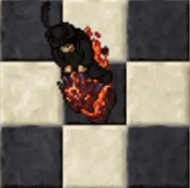 | 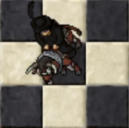 | 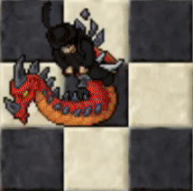 |

| **Brass Speckled Koi**                                                                        | **Wrathfire**                                                               | **Spirit of Purity**                                                                      |
| --------------------------------------------------------------------------------------------- | --------------------------------------------------------------------------- | ----------------------------------------------------------------------------------------- |
| 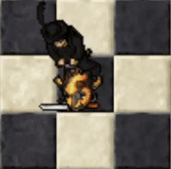 | 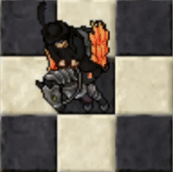 | 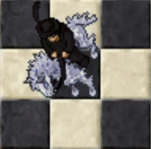 |

| **Skybreaker Pegasus**                                                                        | **Bog Tyrant**                                                                |
| --------------------------------------------------------------------------------------------- | ----------------------------------------------------------------------------- |
| 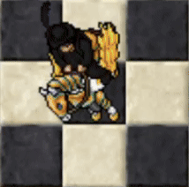 | 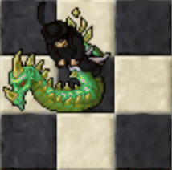 |

| **Ether Badger**                                                                  | **Flamesteed**                                                                | **Flying Divan**                                                                  |
| --------------------------------------------------------------------------------- | ----------------------------------------------------------------------------- | --------------------------------------------------------------------------------- |
| 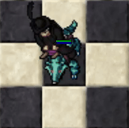 | 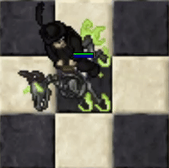 | 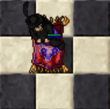 |

| **Jade Lion**                                                               | **Magic Carpet**                                                                  | **Nightmarish Crocovile**                                                                           |
| --------------------------------------------------------------------------- | --------------------------------------------------------------------------------- | --------------------------------------------------------------------------------------------------- |
| 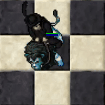 | 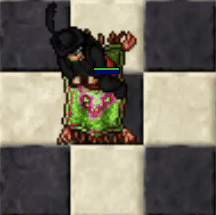 | 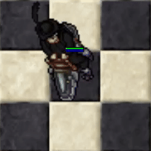 |

| **Savanna Ostrich**                                                                     | **Sea Devil**                                                               |
| --------------------------------------------------------------------------------------- | --------------------------------------------------------------------------- |
| 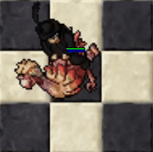 | 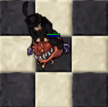 |

The following mounts are **obtainable in-game**:

| **War Bear**                                                              | **Black Sheep**                                                                 | **War Horse**                                                               |
| ------------------------------------------------------------------------- | ------------------------------------------------------------------------------- | --------------------------------------------------------------------------- |
| 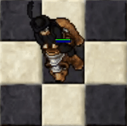 | 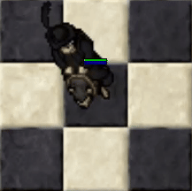 | 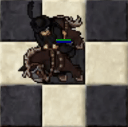 |

| **Tamed Panda**                                                                 | **Donkey**                                                            | **Kingly Deer**                                                                 |
| ------------------------------------------------------------------------------- | --------------------------------------------------------------------- | ------------------------------------------------------------------------------- |
| 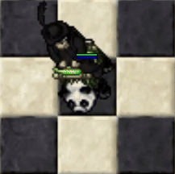 | 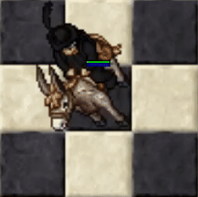 | 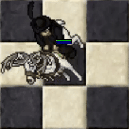 |

| **Ursagrodon**                                                               | **Racing Bird**                                                                | **Dromedary**                                                               |
| ---------------------------------------------------------------------------- | ------------------------------------------------------------------------------ | --------------------------------------------------------------------------- |
| 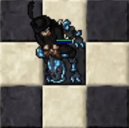 | 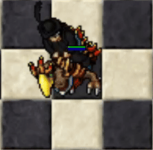 | 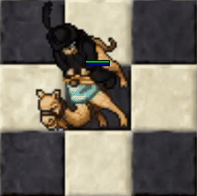 |

| **Rapid Boar**                                                                | **Widow Queen**                                                                 | **Lady Bug**                                                             |
| ----------------------------------------------------------------------------- | ------------------------------------------------------------------------------- | ------------------------------------------------------------------------ |
| 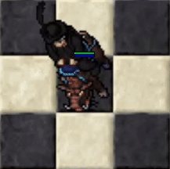 | 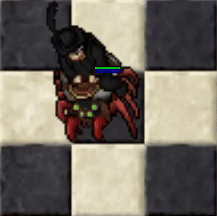 | 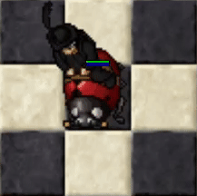 |

| **Scorpion King**                                                                   | **Uniwheel**                                                              | **Dragonling**                                                                |
| ----------------------------------------------------------------------------------- | ------------------------------------------------------------------------- | ----------------------------------------------------------------------------- |
| 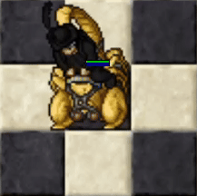 | 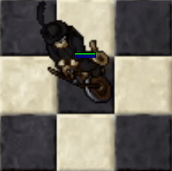 | 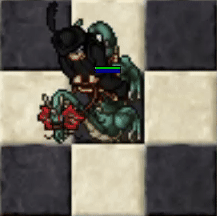 |

| **Titanica**                                                              | **Undead Cavebear**                                                                     | **Draptor**                                                             |
| ------------------------------------------------------------------------- | --------------------------------------------------------------------------------------- | ----------------------------------------------------------------------- |
| 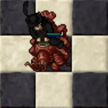 | 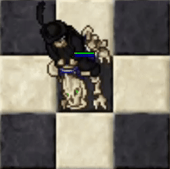 | 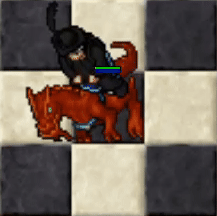 |

| **Midnight Panther**                                                                      | **Magma Crawler**                                                                   | **Manta Ray**                                                           |
| ----------------------------------------------------------------------------------------- | ----------------------------------------------------------------------------------- | ----------------------------------------------------------------------- |
| 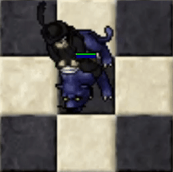 | 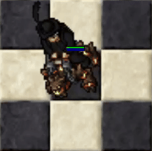 | 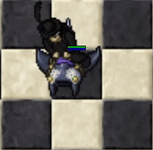 |

**Special Mounts**

* Arctic Unicorn - Aedis reset

* Blazing Unicorn - Tournament top 10

**Normal Mount Dolls** 100 points each, 80 mounts total.

Normal Mount Doll List (click to expand)

1. Antelope
2. Batcat
3. Battle Badger
4. Blackpelt
5. Blazebringer
6. Boisterous Bull
7. Cave Tarantula
8. Copper Fly
9. Coralripper
10. Cranium Spider
11. Crystal Wolf
12. Dawn Strayer
13. Doombringer
14. Dreadhare
15. Dusk Pryer
16. Ebony Tiger
17. Emerald Waccoon
18. Ember Saurian
19. Ether Badger
20. Feral Tiger
21. Flamesteed
22. Flitterkatzen
23. Floating Augur
24. Floating Sage
25. Floating Scholar
26. Glooth Glider
27. Glacier Vagabond
28. Golden Dragonfly
29. Gnarlhound
30. Hailstorm Fury
31. Haze
32. Highland Yak
33. Jackalope
34. Jade Shrine
35. Jungle Saurian
36. Jungle Tiger
37. Lagoon Saurian
38. Marsh Toad
39. Mole
40. Mould Shell
41. Nethersteed
42. Nightmareish Crocovile
43. Nightstinger
44. Night Waccoon
45. Obstinate Ox
46. Peach Plumfish
47. Poisonbane
48. Razorcreep
49. Reed Lurker
50. Rented Horse
51. Rented Horse
52. Rented Horse
53. Rift Runner
54. Ringtail Waccoon
55. River Crocovile
56. Sanguine Frog
57. Savanna Ostrich
58. Sea Devil
59. Shock Head
60. Siegebreaker
61. Slagsnare
62. Snow Strider
63. Stampor
64. Steel Bee
65. Surly Steer
66. Swamp Crocovile
67. Swamp Snapper
68. Tawny Owl
69. Tempest
70. The Hellgrip
71. Tiger Slug
72. Tin Lizzard
73. Toxic Toad
74. Tundra Rambler
75. Venompaw
76. Walker
77. Water Buffalo
78. Wolpertinger
79. Woodland Prince
80. Zaoan Badger

**Premium Mount Dolls** 200 points each, 82 mounts total

Premium Mount Doll List (click to expand)

1. Armoured War Horse
2. Azudocus
3. Black Stag
4. Bloodcurl
5. Blue Rolling Barrel
6. Bog Tyrant
7. Boreal Owl
8. Brass Speckled Koi
9. Bunny Dray
10. Carpacosaurus
11. Cerberus Champion
12. Cony Cart
13. Coral Rhea
14. Corpsefire Skull
15. Crimson Fang
16. Crimson Ray
17. Cunning Hyaena
18. Darkfire Devourer
19. Dawnbringer Pegasus
20. Death Crawler
21. Desert King
22. Doom Skull
23. Emerald Sphinx
24. Emperor Deer
25. Eventide Nandu
26. Fleeting Knowledge
27. Floating Kashmir
28. Flying Divan
29. Glacier Wyrm
30. Gold Sphinx
31. Goldfire Skull
32. Gorongra
33. Green Rolling Barrel
34. Hellfire Horse
35. Hibernal Moth
36. Icebreacher
37. Inferno Horse
38. Ink Spotted Koi
39. Ironblight
40. Ivory Fang
41. Jade Lion
42. Jade Pincer
43. Jousting Eagle
44. Lacewing Moth
45. Leafscuttler
46. Magic Carpet
47. Magma Skull
48. Mouldpincer
49. Mystic Jaguar
50. Neon Sparkid
51. Noctungra
52. Parade Horse
53. Platesaurian
54. Rabbit Rickshaw
55. Red Rolling Barrel
56. Ripptor
57. Scruffy Hyaena
58. Shadow Claw
59. Shadow Draptor
60. Shadow Hart
61. Shadow Horn
62. Shadow Skull
63. Shadow Sphinx
64. Silver Drake
65. Silverneck
66. Skybreaker Pegasus
67. Snow Pelt
68. Snowy Owl
69. Sparkion
70. Spectral Horse
71. Spirit Of Purity
72. Steelbeak
73. Stone Rhino
74. Tangerine Flecked Koi
75. Tank
76. Tombstinger
77. Venom Crow
78. Vortexion
79. Voracious Hyaena
80. White Lion
81. Winter King
82. Wrathfire Pegasus

