# Shaders

Shaders in Souls of Elysium add unique visual effects to characters, allowing for further customization and personalization.

| **Blue Energy**                                                                 | **Green Energy**                                                                  | **Outfit Circle**                                                                   |
| ------------------------------------------------------------------------------- | --------------------------------------------------------------------------------- | ----------------------------------------------------------------------------------- |
| 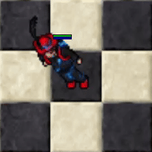 | 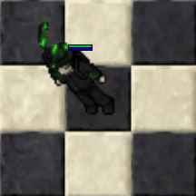 | 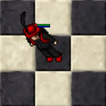 |

| **Outfit Rainbow**                                                                    | **Outfit Stars**                                                                  | **Outfit 3 Line**                                                                   |
| ------------------------------------------------------------------------------------- | --------------------------------------------------------------------------------- | ----------------------------------------------------------------------------------- |
| 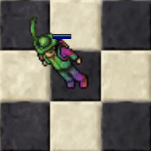 | 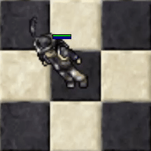 | 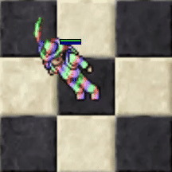 |

| **Outfit Blood**                                                                  | **Outfit Brazil**                                                                   | **Outfit Camouflage**                                                                       |
| --------------------------------------------------------------------------------- | ----------------------------------------------------------------------------------- | ------------------------------------------------------------------------------------------- |
| 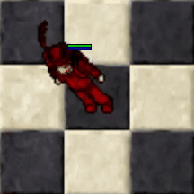 | 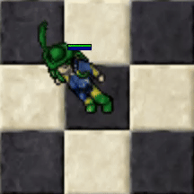 | 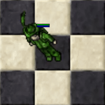 |

| **Outfit Cosmos**                                                                   | **Outfit Glitch**                                                                   | **Outfit Gold**                                                                 |
| ----------------------------------------------------------------------------------- | ----------------------------------------------------------------------------------- | ------------------------------------------------------------------------------- |
| 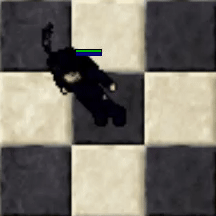 | 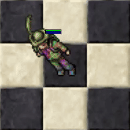 | 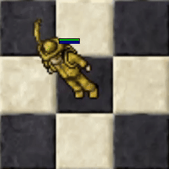 |

| **Outfit Ice**                                                                | **Outfit Line (Dark colour same aura)**                                             | **Outfit Line (light colour same aura)**                                            |
| ----------------------------------------------------------------------------- | ----------------------------------------------------------------------------------- | ----------------------------------------------------------------------------------- |
| 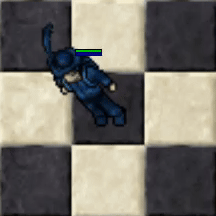 | 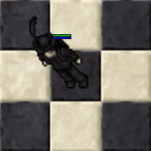 | 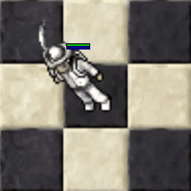 |

| **Outfit Purpleneon**                                                                       | **Outfit Purplesky**                                                                      | **Outfit Shimmering**                                                                       |
| ------------------------------------------------------------------------------------------- | ----------------------------------------------------------------------------------------- | ------------------------------------------------------------------------------------------- |
| 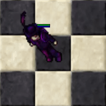 | 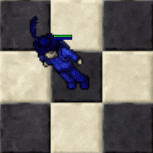 |  |

| **Outfit Static**                                                                   | **Outfit Sun**                                                                | **Outfit Sweden**                                                                   |
| ----------------------------------------------------------------------------------- | ----------------------------------------------------------------------------- | ----------------------------------------------------------------------------------- |
| 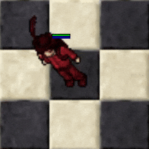 | 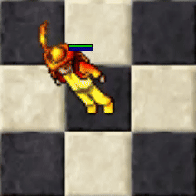 | 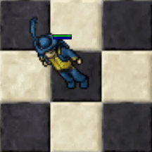 |

| **Purple Energy**                                                                   | **Red Energy**                                                                | **Spirit Fire**                                                                 |
| ----------------------------------------------------------------------------------- | ----------------------------------------------------------------------------- | ------------------------------------------------------------------------------- |
| 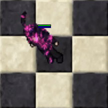 | 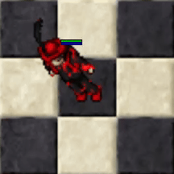 |  |
