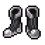
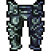
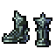

# FH Gear

* Frostheaven Gear is available for all vocations.
* Frostheaven has a level 200 requirement (as of November 2024).




| | Item | Arm | Bonuses | Protection | Weight |
| - | - | - | - | - | - |
|  | **Kakdrak Boots** | 3 | Magic Level +4 Speed +35 Life Leech 4% / 4% +0.5 MP/s | Fire +5% Death +5% | 25.00 oz |
|  | **Angelic Boots** | 3 | Distance +2 Speed +40 Crit 3% / +3% +0.5 MP/s | – | 12.00 oz |



#### Kakdrak Set

Kakdrak Set pieces give mana regeneration.

| | Item | Arm | Bonuses | Protection | Weight |
| - | - | - | - | - | - |
|  | **Kakdrak Hood** | 12 | Magic Level +6 Crit 2% / +3% +1.0 MP/s | – | 12.00 oz |
|  | **Kakdrak Robe** | 12 | Magic Level +7 Crit 3% / +5% +1.0 MP/s | – | 23.00 oz |
|  | **Kakdrak Robe Bottoms** | 12 | Magic Level +6 Crit 3% / +4% +1.0 MP/s | Physical +3% | 18.00 oz |
|  | **Kakdrak Boots** | 3 | Magic Level +4 Speed +35 Life Leech 4% / 4% +0.5 MP/s | Fire +5% Death +5% | 25.00 oz |

#### Wand & Spellbook

| | Item | Element | Def | Range | Bonuses | Protection | Weight |
| - | - | - | - | - | - | - | - |
|  | **Wand Of The Stars** _250-350 damage @ +10_ | yellowdart | – | 8 | Magic Level +7 Crit 3% / +3% | – | 15.00 oz |
|  | **Spellbook Of Soul Steal** | – | 20 | – | Magic Level +6 Life Leech 5% / 5% +0.5 MP/s | Physical +5% Death +8% | 17.00 oz |



#### Gurukk Set (two-handed)

| | Item | Arm | Bonuses | Protection | Weight |
| - | - | - | - | - | - |
|  | **Gurukk Helmet** | 10 | Two-handed +5 Crit damage +4% Attack Speed +0.03s | Physical +4% | 35.00 oz |
|  | **Gurukk Chestplate** | 20 | Two-handed +8 Crit damage +5% Attack Speed +0.05s | Physical +6% | 75.00 oz |
|  | **Gurukk Platelegs** | 11 | Two-handed +7 Crit damage +4% Attack Speed +0.04s | Physical +5% | 42.00 oz |
|  | **Gurukk Boots** | 4 | Speed +30 Crit 2% / +5% | Physical +5% | 20.00 oz |

#### Zulmthu Set (one-handed)

| | Item | Def | Arm | Bonuses | Protection | Weight |
| - | - | - | - | - | - | - |
|  | **Zulmthu Helmet** | – | 12 | One-handed +5 Crit 3% Attack Speed +0.02s | Physical +5% | 70.00 oz |
|  | **Zulmthu Armor** | – | 20 | One-handed +6 Crit 3% Attack Speed +0.03s | Physical +8% | 100.00 oz |
|  | **Zulmthu Legs** | – | 12 | One-handed +6 Crit 2% Attack Speed +0.02s | Physical +6% | 70.00 oz |
|  | **Zulmthu Boots** | – | 5 | Speed +30 Crit 2% Attack Speed +0.02s | Physical +5% | 42.00 oz |
|  | **Zulmthu Shield** | 44 | – | One-handed +5 Max HP +320 Crit 3% Attack Speed +0.05s | Physical +7% | 78.00 oz |

#### One-Handed Weapons

| | Item | Atk | Def | Bonuses | Weight |
| - | - | - | - | - | - |
|  | **Soul Longsword** | 54 | 30 | Life Leech 12% / 12% Attack Speed +0.15s | 24.50 oz |
|  | **Zulmthu Axe** | 53 | 36 | One-handed +10 Attack Speed +0.20s | 30.00 oz |
|  | **Winterblade** | 6 + 45 ice | 22 +4 | One-handed +4 | 43.00 oz |

#### Two-Handed Weapons

| | Item | Atk | Def | Bonuses | Weight |
| - | - | - | - | - | - |
|  | **Kakdrak Godsword** | 35 + 35 fire | 15 | Crit 5% / +5% | 80.00 oz |
|  | **Zephon Godsword** | 35 + 35 energy | 15 | Crit 5% / +5% | 80.00 oz |
|  | **Gurukk Godsword** | 70 | 15 | Crit 5% / +5% | 80.00 oz |
|  | **Zulmthu Godsword** | 35 + 35 ice | 15 | Crit 5% / +5% | 80.00 oz |



#### Zephon Set

| | Item | Arm | Bonuses | Protection | Weight |
| - | - | - | - | - | - |
|  | **Zephon Helmet** | 10 | Distance +4 Crit 3% Attack Speed +0.05s | Physical +4% | 21.00 oz |
|  | **Zephon Armor** | 17 | Distance +6 Crit 5% Attack Speed +0.07s | Physical +5% | 22.00 oz |
|  | **Zephon Legs** | 10 | Distance +4 Crit 4% Attack Speed +0.06s | Physical +4% | 20.00 oz |
|  | **Angelic Boots** | 3 | Distance +2 Speed +40 Crit 3% / +3% +0.5 MP/s | – | 12.00 oz |

#### Weapons

Paladins can use either the bow or the crossbow.

| | Item | Atk | Range | Bonuses | Weight |
| - | - | - | - | - | - |
|  | **Angelic Crossbow** | 10 | 6 | Distance +5 Attack Speed +0.20s Hit +6% | 35.00 oz |
|  | **Magic Bow** | 9 | 7 | Distance +7 Attack Speed +0.22s Hit +7% | 47.00 oz |



