# Item Browser

* One tab per slot. Each list is sorted by the stat that matters most for it: Armor for armor pieces, Attack for weapons, Defense for shields.
* Use your browser's find (`Ctrl+F`) to jump to an item.




_102 items, sorted by Armor._

| | Item | Arm | Bonuses | Protection | Weight |
| - | - | - | - | - | - |
|  | **Helmet Of The Ancients** | 13 | – | Physical +5% | 27.60 oz |
|  | **Kakdrak Hood** _Sorcerers and Druids only, Faster mana regen lvl 250+_ | 12 | Magic Level +6 Crit 2% / +3% +1.0 MP/s | – | 12.00 oz |
|  | **Vitality Helmet** | 12 | Max HP +90 | – | 80.00 oz |
|  | **Zulmthu Helmet** _Knights only lvl 250+_ | 12 | One-handed +5 Crit 3% Attack Speed +0.02s | Physical +5% | 70.00 oz |
|  | **Horned Helmet** | 11 | – | – | 51.00 oz |
|  | **Demon Helmet** | 10 | – | Physical +2% Fire +3% | 29.50 oz |
|  | **Falcon Coif** | 10 | Distance +2 Shielding +2 | Physical +3% Fire +10% | 28.00 oz |
|  | **Gurukk Helmet** _Knights only lvl 250+_ | 10 | Two-handed +5 Crit damage +4% Attack Speed +0.03s | Physical +4% | 35.00 oz |
|  | **Obsidian Helmet** _lvl 150+_ | 10 | One-handed +1 Two-handed +1 Distance +1 +0.5 HP/s +0.5 MP/s | Physical +3% Death +2% Holy -2% | 34.00 oz |
|  | **Rune Plate Helmet** | 10 | One-handed +4 Two-handed +4 | Physical +3% | 80.00 oz |
|  | **Visage Of The End Days** | 10 | Magic Level +4 | Death +10% | 38.00 oz |
|  | **Winged Helmet** | 10 | Attack Speed +0.05s | – | 12.00 oz |
|  | **Zephon Helmet** _Paladins only lvl 250+_ | 10 | Distance +4 Crit 3% Attack Speed +0.05s | Physical +4% | 21.00 oz |
|  | **Adamant Plate Helmet** | 9 | One-handed +3 Two-handed +3 | Physical +2% | 85.00 oz |
|  | **Cobra Hood** | 9 | Magic Level +2 One-handed +3 Two-handed +3 Distance +3 | Physical +5% Earth +8% | 27.00 oz |
|  | **Dragon Scale Helmet** | 9 | – | – | 60.00 oz |
|  | **Elite Draken Helmet** | 9 | Distance +2 | Physical +3% Death +3% | 43.00 oz |
|  | **Iron Helmet (G)** | 9 | – | – | 6.00 oz |
|  | **Mithril Plate Helmet** | 9 | One-handed +2 Two-handed +2 | Physical +2% | 80.00 oz |
|  | **Prismatic Helmet** | 9 | One-handed +3 Two-handed +3 Shielding +3 | – | 56.00 oz |
|  | **Royal Helmet** | 9 | – | – | 48.00 oz |
|  | **Royal Helmet (G)** | 9 | – | – | 7.00 oz |
|  | **Rune Wizard Hat** | 9 | Magic Level +4 Max HP +100 +1.0 MP/s | – | 33.00 oz |
|  | **Skull Helmet** | 9 | – | – | 42.00 oz |
|  | **Terra Helmet** | 9 | One-handed +2 Two-handed +2 | Physical +5% Earth +5% | 31.00 oz |
|  | **Undergrowth Helmet** | 9 | Magic Level +3 | Fire -10% Earth +10% | 20.00 oz |
|  | **Zaoan Helmet** | 9 | – | Physical +4% | 66.00 oz |
|  | **Adamant Ranger Helmet** | 8 | Distance +3 | Physical +2% | 57.00 oz |
|  | **Adamant Wizard Hat** | 8 | Magic Level +3 Max HP +60 | – | 35.00 oz |
|  | **Crusader Helmet** | 8 | – | – | 52.00 oz |
|  | **Crusader Helmet (G)** | 8 | – | – | 8.00 oz |
|  | **Falcon Circlet** | 8 | Magic Level +3 | Fire +9% | 13.00 oz |
|  | **Fiery Helmet** | 8 | – | Fire +4% Ice -4% | 40.00 oz |
|  | **Golden Plate Helmet** | 8 | One-handed +1 Two-handed +1 | Physical +1% | 80.00 oz |
|  | **Golden Ranger Helmet** | 8 | Distance +2 | Physical +1% | 55.00 oz |
|  | **Mithril Ranger Helmet** | 8 | Distance +2 | Physical +2% | 60.00 oz |
|  | **Mithril Wizard Hat** | 8 | Magic Level +2 Max HP +40 | – | 40.00 oz |
|  | **Ranger Helmet** | 8 | – | – | 27.60 oz |
|  | **Royal Blue Helmet** | 8 | Speed +40 | – | 27.60 oz |
|  | **Warrior Helmet** | 8 | – | – | 68.00 oz |
|  | **Warrior Helmet (G)** | 8 | – | – | 12.00 oz |
|  | **Amazon Helmet** | 7 | – | – | 29.50 oz |
|  | **Beholder Helmet** | 7 | – | – | 46.00 oz |
|  | **Crown Helmet** | 7 | – | – | 29.50 oz |
|  | **Dark Whispers** | 7 | Magic Level +5 | Ice +3% | 34.00 oz |
|  | **Devil Helmet** | 7 | – | – | 50.00 oz |
|  | **Golden Wizard Hat** | 7 | Magic Level +1 Max HP +30 | – | 40.00 oz |
|  | **Helmet Of The Lost** | 7 | – | – | 35.00 oz |
|  | **Iron Plate Helmet** | 7 | – | Physical +1% | 72.00 oz |
|  | **Iron Ranger Helmet** | 7 | Distance +1 | – | 49.00 oz |
|  | **Shroud Of Despair** | 7 | Magic Level +2 Distance +2 Speed +20 | Death +3% | 34.00 oz |
|  | **Bronze Plate Helmet** | 6 | – | Physical +1% | 60.00 oz |
|  | **Bronze Ranger Helmet** | 6 | Distance +1 | – | 45.00 oz |
|  | **Dark Helmet** | 6 | – | – | 46.00 oz |
|  | **Dwarven Helmet** | 6 | – | – | 42.00 oz |
|  | **Horseman Helmet** | 6 | – | – | 42.00 oz |
|  | **Iron Wizard Hat** | 6 | Magic Level +1 Max HP +25 | – | 38.00 oz |
|  | **Krimhorn Helmet** | 6 | – | – | 51.00 oz |
|  | **Ragnir Helmet** | 6 | – | – | 31.00 oz |
|  | **Steel Helmet** | 6 | – | – | 46.00 oz |
|  | **Strange Helmet** | 6 | – | – | 46.00 oz |
|  | **Strange Helmet (G)** | 6 | – | – | 4.00 oz |
|  | **Blue Hat** _Sorcerers and Druids only_ | 5 | Magic Level +5 | Energy +5% Earth -8% | 12.00 oz |
|  | **Bronze Wizard Hat** | 5 | Magic Level +1 | – | 29.00 oz |
|  | **Gill Gugel** | 5 | Magic Level +2 | Fire -6% Earth +6% | 9.00 oz |
|  | **Glacier Mask** | 5 | – | Ice +4% Energy -5% | 10.00 oz |
|  | **Iron Helmet** | 5 | – | – | 30.00 oz |
|  | **Lightning Headband** | 5 | – | Energy +4% Earth -5% | 10.00 oz |
|  | **Magma Monocle** | 5 | – | Fire +4% Ice -5% | 10.00 oz |
|  | **Soldier Helmet** | 5 | – | – | 32.00 oz |
|  | **Terra Hood** | 5 | – | Fire -5% Earth +4% | 10.00 oz |
|  | **Yalahari Mask** | 5 | Magic Level +2 | – | 35.00 oz |
|  | **Jade Hat** | 4 | Magic Level +1 | – | 9.00 oz |
|  | **Legion Helmet** | 4 | – | – | 31.00 oz |
|  | **Legion Helmet (G)** | 4 | – | – | 4.00 oz |
|  | **Shamanic Mask** | 4 | – | – | 31.00 oz |
|  | **Viking Helmet** | 4 | – | – | 39.00 oz |
|  | **Viking Helmet (G)** | 4 | – | – | 7.00 oz |
|  | **Batwing Hat** | 3 | Magic Level +1 | – | 6.00 oz |
|  | **Brass Helmet** | 3 | – | – | 27.00 oz |
|  | **Cobra Crown** | 3 | Magic Level +2 | Fire -5% Earth +5% | 8.50 oz |
|  | **Fur Cap** | 3 | – | – | 18.00 oz |
|  | **Hat Of The Mad** _Looks somewhat silly_ | 3 | Magic Level +1 | – | 7.00 oz |
|  | **Mage'S Cap** | 3 | – | Fire +4% | 10.00 oz |
|  | **Pirate Hat** | 3 | – | – | 12.50 oz |
|  | **Witch Hat** | 3 | – | Mana Drain +5% | 7.80 oz |
|  | **Chain Helmet** | 2 | – | – | 42.00 oz |
|  | **Charmer'S Tiara** | 2 | – | – | 22.00 oz |
|  | **Feather Headdress** | 2 | – | – | 21.00 oz |
|  | **Helmet Of The Deep** | 2 | Speed +300 | – | 210.00 oz |
| 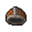 | **Studded Helmet** | 2 | – | – | 24.50 oz |
|  | **Tribal Mask** | 2 | – | – | 25.00 oz |
|  | **Bandana** | 1 | – | – | 8.50 oz |
|  | **Ferumbras' Hat** | 1 | Magic Level +5 Speed +10 Max HP +100 | Physical -6% | 8.50 oz |
|  | **Leather Helmet** | 1 | – | – | 22.00 oz |
|  | **Magician Hat** | 1 | – | – | 7.50 oz |
|  | **Mystic Turban** | 1 | – | – | 8.50 oz |
|  | **Party Hat** | 1 | – | – | 7.50 oz |
|  | **Spooky Hood** | 1 | – | – | 12.50 oz |
|  | **Ancient Tiara** | 0 | – | – | 4.50 oz |
|  | **Flower Wreath** | – | – | – | 5.00 oz |
|  | **Pair Of Earmuffs** | 0 | – | Ice +2% | 5.00 oz |



_141 items, sorted by Armor._

| | Item | Arm | Bonuses | Protection | Weight |
| - | - | - | - | - | - |
|  | **Gurukk Chestplate** | 20 | Two-handed +8 Crit damage +5% Attack Speed +0.05s | Physical +6% | 75.00 oz |
|  | **Vitality Armor** | 20 | Max HP +120 | – | 80.00 oz |
|  | **Zulmthu Armor** | 20 | One-handed +6 Crit 3% Attack Speed +0.03s | Physical +8% | 100.00 oz |
|  | **Earthheart Hauberk** | 18 | One-handed +4 Two-handed +4 | Fire -8% Earth +8% | 145.00 oz |
|  | **Earthheart Platemail** | 18 | One-handed +4 Two-handed +4 | Physical +6% Fire -8% Earth +8% | 145.00 oz |
| 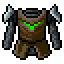 | **Earthsoul Tabard** | 18 | Distance +4 | Fire -8% Earth +8% | 145.00 oz |
|  | **Falcon Plate** | 18 | One-handed +3 Two-handed +3 | Physical +7% | 188.00 oz |
|  | **Fireheart Hauberk** | 18 | One-handed +4 Two-handed +4 | Fire +8% Ice -8% | 145.00 oz |
|  | **Fireheart Platemail** | 18 | One-handed +4 Two-handed +4 | Physical +6% Fire +8% Ice -8% | 145.00 oz |
|  | **Firesoul Tabard** | 18 | Distance +4 | Fire +8% Ice -8% | 145.00 oz |
|  | **Frostheart Hauberk** | 18 | One-handed +4 Two-handed +4 | Ice +8% Energy -8% | 145.00 oz |
|  | **Frostheart Platemail** | 18 | One-handed +4 Two-handed +4 | Physical +6% Ice +8% Energy -8% | 145.00 oz |
|  | **Frostsoul Tabard** | 18 | Distance +4 | Ice +8% Energy -8% | 145.00 oz |
|  | **Thunderheart Hauberk** | 18 | One-handed +4 Two-handed +4 | Energy +8% Earth -8% | 145.00 oz |
|  | **Thunderheart Platemail** | 18 | One-handed +4 Two-handed +4 | Physical +6% Energy +8% Earth -8% | 145.00 oz |
|  | **Thundersoul Tabard** | 18 | Distance +4 | Energy +8% Earth -8% | 145.00 oz |
|  | **Ghost Chestplate** | 17 | Distance +2 | Physical +3% | 123.00 oz |
|  | **Magic Plate Armor** | 17 | – | – | 85.00 oz |
|  | **Magic Plate Armor (G)** | 17 | – | – | 20.00 oz |
|  | **Undergrowth Chestplate** | 17 | One-handed +5 Two-handed +5 | Physical +4% Earth +14% | 40.00 oz |
|  | **Zephon Armor** | 17 | Distance +6 Crit 5% Attack Speed +0.07s | Physical +5% | 22.00 oz |
|  | **Demon Armor** | 16 | – | Physical +2% Fire +3% | 80.00 oz |
|  | **Earthheart Cuirass** | 16 | Magic Level +4 | Fire -8% Earth +8% | 145.00 oz |
|  | **Embrace Of Nature** | 16 | Distance +4 Speed +15 Attack Speed +0.05s | Ice +11% Energy -3% | 24.00 oz |
|  | **Fireheart Cuirass** | 16 | Magic Level +4 | Fire +8% Ice -8% | 45.00 oz |
|  | **Frostheart Cuirass** | 16 | Magic Level +4 | Ice +8% Energy -8% | 145.00 oz |
|  | **Mithril Armor** | 16 | Distance +3 | – | 10.00 oz |
|  | **Obsidian Coat** | 16 | Magic Level +3 Speed +10 | Physical +3% Death +5% Holy -5% | 17.00 oz |
|  | **Ornate Chestplate** | 16 | Shielding +3 | Physical +8% | 156.00 oz |
|  | **Thunderheart Cuirass** | 16 | Magic Level +4 | Energy +8% Earth -8% | 145.00 oz |
|  | **Toga Mortis** | 16 | Magic Level +5 | Physical +5% Death +6% | 52.00 oz |
|  | **Undergrowth Robe** | 16 | Magic Level +4 | Fire -12% Earth +12% | 27.00 oz |
|  | **Yalahari Armor** | 16 | – | Death +3% | 70.00 oz |
|  | **Dragon Scale Mail** | 15 | – | – | 114.00 oz |
|  | **Earthborn Titan Armor** | 15 | One-handed +2 Two-handed +2 | Physical +2% Fire -5% Earth +5% | 120.00 oz |
|  | **Earthmind Raiment** | 15 | Magic Level +5 | Fire -5% Earth +10% | 55.00 oz |
|  | **Elite Draken Mail** | 15 | Speed +10 | – | 120.00 oz |
|  | **Fireborn Giant Armor** | 15 | One-handed +2 Two-handed +2 | Physical +2% Fire +5% Ice -5% | 120.00 oz |
|  | **Firemind Raiment** | 15 | Magic Level +5 | Fire +10% Ice -5% | 55.00 oz |
|  | **Frostmind Raiment** | 15 | Magic Level +5 | Ice +10% Energy -5% | 55.00 oz |
|  | **Master Archer'S Armor** | 15 | Distance +3 Speed +10 | Physical +1% | 69.00 oz |
|  | **Oceanborn Leviathan Armor** | 15 | Shielding +1 | Ice +5% Energy -5% | 100.00 oz |
|  | **Retro Crown Armor** | 15 | – | – | 99.00 oz |
|  | **Rune Plate Armor** | 15 | One-handed +4 Two-handed +4 | Physical +3% | 132.00 oz |
|  | **Thundermind Raiment** | 15 | Magic Level +5 | Energy +10% Earth -4% | 55.00 oz |
|  | **Windborn Colossus Armor** | 15 | One-handed +2 Two-handed +2 | Physical +2% Energy +5% Earth -5% | 120.00 oz |
|  | **Adamant Plate Armor** | 14 | One-handed +3 Two-handed +3 | Physical +2% | 140.00 oz |
|  | **Golden Armor** | 14 | – | – | 80.00 oz |
|  | **Skullcracker Armor** | 14 | – | Death +5% Holy -5% | 110.00 oz |
|  | **Adamant Ranger Armor** | 13 | Distance +3 | Physical +2% | 75.00 oz |
|  | **Amazon Armor** | 13 | – | – | 99.00 oz |
|  | **Crown Armor** | 13 | – | – | 99.00 oz |
|  | **Crystalline Armor** | 13 | – | Ice +3% Energy -3% | 84.50 oz |
|  | **Divine Plate** | 13 | – | Death +10% Holy -10% | 75.00 oz |
|  | **Fiery Armor** | 13 | – | Fire +8% Ice -8% | 40.00 oz |
|  | **Frozen Plate** | 13 | – | Ice +7% Energy -7% | 75.00 oz |
|  | **Lavos Armor** | 13 | – | Fire +3% Ice -3% | 85.00 oz |
|  | **Living Armor** | 13 | Magic Level +2 | Fire -5% Earth +12% | 48.00 oz |
|  | **Mithril Plate Armor** | 13 | One-handed +2 Two-handed +2 | Physical +2% | 140.00 oz |
|  | **Mithril Ranger Armor** | 13 | Distance +2 | Physical +2% | 80.00 oz |
|  | **Molten Plate** | 13 | – | Fire +7% Ice -7% | 75.00 oz |
|  | **Rune Wizard Robe** | 13 | Magic Level +4 Max HP +100 +1.0 MP/s | – | 40.00 oz |
|  | **Swamplair Armor** | 13 | – | Fire -3% Earth +3% | 84.50 oz |
|  | **Voltage Armor** | 13 | – | Energy +3% Earth -3% | 84.50 oz |
|  | **Zaoan Armor** | 13 | Speed +10 | – | 95.50 oz |
|  | **Buckle** | 12 | – | – | 75.00 oz |
|  | **Calopteryx Cape** | 12 | Magic Level +1 | Ice +5% | 20.00 oz |
|  | **Dragon Robe** | 12 | – | Fire +12% Ice -12% | 28.50 oz |
|  | **Dream Shroud** | 12 | Magic Level +3 | Energy +10% Earth -10% | 25.00 oz |
|  | **Furious Frock** | 12 | Magic Level +5 Speed +15 | Fire +10% | 34.00 oz |
|  | **Golden Plate Armor** | 12 | One-handed +1 Two-handed +1 | Physical +1% | 130.00 oz |
|  | **Golden Ranger Armor** | 12 | Distance +2 | Physical +1% | 78.00 oz |
|  | **Goo Shell** | 12 | – | Fire -2% Earth +2% | 58.00 oz |
|  | **Greenwood Coat** | 12 | – | Fire -12% Earth +12% | 28.50 oz |
|  | **Kakdrak Robe** | 12 | Magic Level +7 Crit 3% / +5% +1.0 MP/s | – | 23.00 oz |
|  | **Knight Armor** | 12 | – | – | 120.00 oz |
|  | **Paladin Armor** | 12 | Distance +2 | – | 65.00 oz |
|  | **Robe Of The Underworld** | 12 | – | Physical +6% Death +6% Holy -6% | 31.00 oz |
|  | **Royal Scale Robe** | 12 | Magic Level +2 | Fire +5% | 45.00 oz |
| 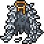 | **Swan Feather Cloak** | 12 | Speed +10 | Energy +12% Earth +12% | 4.00 oz |
|  | **The Robe Of The Ice Queen** | 12 | Magic Level +4 | Ice +12% Energy -12% | 29.50 oz |
|  | **Velvet Mantle** | 12 | – | Energy +12% Earth -12% | 28.50 oz |
|  | **Adamant Wizard Robe** | 11 | Magic Level +3 Max HP +60 | – | 44.00 oz |
|  | **Albino Plate** | 11 | – | – | 84.00 oz |
|  | **Blue Robe** | 11 | – | – | 22.00 oz |
|  | **Blue Robe (G)** | 11 | – | – | 3.00 oz |
|  | **Fur Armor** | 11 | – | Ice +5% Earth +5% | 49.00 oz |
|  | **Glacier Robe** | 11 | – | Ice +8% Energy -8% | 22.50 oz |
|  | **Iron Plate Armor** | 11 | – | Physical +1% | 118.00 oz |
|  | **Iron Ranger Armor** | 11 | Distance +1 | – | 72.00 oz |
|  | **Lightning Robe** | 11 | – | Energy +8% Earth -8% | 22.50 oz |
|  | **Magma Coat** | 11 | – | Fire +8% Ice -8% | 22.50 oz |
|  | **Noble Armor** | 11 | – | – | 120.00 oz |
|  | **Spellweaver'S Robe** | 11 | – | Energy +10% Earth -10% | 23.50 oz |
|  | **Terra Mantle** | 11 | – | Fire -8% Earth +8% | 22.50 oz |
|  | **Witchhunter'S Coat** | 11 | – | Death +2% Holy -2% | 25.00 oz |
|  | **Zaoan Robe** | 11 | – | Fire +10% Ice -10% | 24.50 oz |
|  | **Belted Cape** | 10 | – | – | 35.00 oz |
|  | **Bronze Plate Armor** | 10 | – | Physical +1% | 120.00 oz |
|  | **Bronze Ranger Armor** | 10 | Distance +1 | – | 70.00 oz |
|  | **Chain Armor (G)** | 10 | – | – | 10.00 oz |
|  | **Dark Armor** | 10 | – | – | 120.00 oz |
|  | **Dwarven Armor** | 10 | Magic Level +2 | Physical +7% | 130.00 oz |
|  | **Knight Armor (G)** | 10 | – | – | 10.00 oz |
|  | **Mammoth Fur Cape** | 10 | – | – | 20.00 oz |
|  | **Mithril Wizard Robe** | 10 | Magic Level +2 Max HP +40 | – | 49.00 oz |
|  | **Plate Armor** | 10 | – | – | 120.00 oz |
|  | **Plate Armor (G)** | 10 | – | – | 13.00 oz |
|  | **Ranger Armor** | 10 | – | – | 120.00 oz |
|  | **Dark Lord'S Cape** | 9 | Magic Level +2 Speed +-5 | Physical +2% Death +4% Holy -8% | 29.00 oz |
|  | **Elven Mail** | 9 | – | – | 90.00 oz |
|  | **Focus Cape** | 9 | Magic Level +1 | – | 21.00 oz |
|  | **Golden Wizard Robe** | 9 | Magic Level +1 Max HP +30 | – | 42.00 oz |
|  | **Leather Harness** | 9 | – | – | 29.00 oz |
|  | **Leopard Armor** | 9 | – | – | 95.00 oz |
|  | **Scale Armor** | 9 | – | – | 75.00 oz |
|  | **Scale Armor (G)** | 9 | – | – | 15.00 oz |
|  | **Brass Armor** | 8 | – | – | 80.00 oz |
|  | **Brass Armor (G)** | 8 | – | – | 10.00 oz |
|  | **Iron Wizard Robe** | 8 | Magic Level +1 Max HP +25 | – | 40.00 oz |
|  | **Spirit Cloak** | 8 | Magic Level +1 | – | 26.50 oz |
|  | **Bronze Wizard Robe** | 7 | Magic Level +1 | – | 35.00 oz |
|  | **Ethno Coat** | 7 | Magic Level +1 | – | 25.50 oz |
|  | **Magician'S Robe** | 7 | – | – | 35.00 oz |
|  | **Ranger'S Cloak** | 7 | Distance +1 | – | 48.00 oz |
|  | **Chain Armor** | 6 | – | – | 100.00 oz |
|  | **Studded Armor** | 5 | – | – | 50.00 oz |
|  | **Studden Armor (G)** | 5 | – | – | 8.00 oz |
|  | **Leather Armor** | 4 | – | – | 60.00 oz |
|  | **Pirate Shirt** | 3 | – | – | 20.00 oz |
|  | **Doublet** | 2 | – | – | 25.00 oz |
|  | **Red Tunic** | 2 | – | – | 30.00 oz |
|  | **Cape** | 1 | – | – | 32.00 oz |
|  | **Coat** | 1 | – | – | 27.00 oz |
|  | **Green Tunic** | 1 | – | – | 9.30 oz |
|  | **Jacket** | 1 | – | – | 24.00 oz |
|  | **Red Robe** | 1 | – | – | 26.00 oz |
|  | **Ball Gown** | – | – | – | 25.00 oz |
|  | **Flower Dress** | – | – | – | 19.00 oz |
|  | **Hibiscus Dress** | 0 | – | – | 19.00 oz |
|  | **Simple Dress** | – | – | – | 24.00 oz |



_64 items, sorted by Armor._

| | Item | Arm | Bonuses | Protection | Weight |
| - | - | - | - | - | - |
|  | **Vitality Legs** | 14 | Max HP +100 | – | 80.00 oz |
|  | **Kakdrak Robe Bottoms** | 12 | Magic Level +6 Crit 3% / +4% +1.0 MP/s | Physical +3% | 18.00 oz |
|  | **Zulmthu Legs** | 12 | One-handed +6 Crit 2% Attack Speed +0.02s | Physical +6% | 70.00 oz |
| 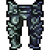 | **Gurukk Platelegs** | 11 | Two-handed +7 Crit damage +4% Attack Speed +0.04s | Physical +5% | 42.00 oz |
|  | **Dragon Scale Legs** | 10 | Fire damage +5% | – | 48.00 oz |
|  | **Falcon Greaves** | 10 | One-handed +3 Two-handed +3 Distance +3 | Physical +4% Ice +7% | 36.00 oz |
| 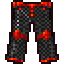 | **Knight Legs (G)** | 10 | – | – | 10.00 oz |
|  | **Soulshanks** | 10 | Magic Level +4 | Death +10% | 38.00 oz |
|  | **Zephon Legs** | 10 | Distance +4 Crit 4% Attack Speed +0.06s | Physical +4% | 20.00 oz |
|  | **Adamant Plate Legs** | 9 | One-handed +3 Two-handed +3 | Physical +2% | 80.00 oz |
|  | **Furious Legs** | 9 | Magic Level +3 Speed +15 | Fire +6% | 22.00 oz |
|  | **Gnome Legs** | 9 | Magic Level +4 | Ice -7% Energy +7% | 25.00 oz |
|  | **Golden Legs** | 9 | – | – | 56.00 oz |
|  | **Mithril Plate Legs** | 9 | One-handed +2 Two-handed +2 | Physical +2% | 82.00 oz |
|  | **Obsidian Legs** | 9 | Speed +15 | Physical +4% Death +4% Holy -4% | 32.00 oz |
|  | **Rune Plate Legs** | 9 | One-handed +4 Two-handed +4 | Physical +3% | 77.00 oz |
|  | **Rune Wizard Legs** | 9 | Magic Level +4 Max HP +100 +1.0 MP/s | – | 37.00 oz |
|  | **Undergrowth Legs** | 9 | Magic Level +2 | Fire -10% Earth +10% | 15.00 oz |
| 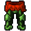 | **Adamant Ranger Legs** | 8 | Distance +3 | Physical +2% | 50.00 oz |
|  | **Adamant Wizard Legs** | 8 | Magic Level +3 Max HP +60 | – | 40.00 oz |
|  | **Blue Legs** | 8 | – | – | 18.00 oz |
|  | **Crown Legs** | 8 | – | – | 65.00 oz |
|  | **Depth Ocrea** | 8 | – | Mana Drain +15% | 48.00 oz |
|  | **Glacier Kilt** | 8 | – | Ice +6% Energy -6% | 19.00 oz |
|  | **Golden Plate Legs** | 8 | One-handed +1 Two-handed +1 | Physical +1% | 70.00 oz |
|  | **Golden Ranger Legs** | 8 | Distance +2 | Physical +1% | 60.00 oz |
|  | **Icy Culotte** | 8 | Magic Level +3 | Ice +8% | 15.00 oz |
|  | **Knight Legs** | 8 | – | – | 70.00 oz |
|  | **Lightning Legs** | 8 | – | Energy +6% Earth -6% | 19.00 oz |
|  | **Magma Legs** | 8 | – | Fire +6% Ice -6% | 19.00 oz |
|  | **Mithril Ranger Legs** | 8 | Distance +2 | Physical +2% | 60.00 oz |
|  | **Mithril Wizard Legs** | 8 | Magic Level +2 Max HP +40 | – | 45.00 oz |
| 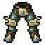 | **Ornate Legs** | 8 | – | Physical +5% | 77.00 oz |
|  | **Retro Crown Legs** | 8 | – | – | 65.00 oz |
|  | **Soulful Legs** | 8 | Magic Level +1 | Holy +8% | 38.00 oz |
|  | **Terra Legs** | 8 | – | Fire -6% Earth +6% | 19.00 oz |
|  | **Yalahari Leg Piece** | 8 | Distance +2 | Death +5% | 65.00 oz |
|  | **Zaoan Legs** | 8 | – | Physical +2% | 66.00 oz |
| 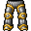 | **Dwarven Legs** | 7 | Magic Level +2 | Physical +5% | 49.00 oz |
|  | **Gill Legs** | 7 | Magic Level +1 | Fire -8% Earth +8% | 28.00 oz |
|  | **Golden Wizard Legs** | 7 | Magic Level +1 Max HP +30 | – | 38.00 oz |
| 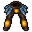 | **Grasshopper Legs** | 7 | Speed +10 | – | 32.00 oz |
|  | **Iron Plate Legs** | 7 | – | Physical +1% | 80.00 oz |
|  | **Iron Ranger Legs** | 7 | Distance +1 | – | 62.00 oz |
| 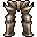 | **Plate Legs** | 7 | – | – | 50.00 oz |
| 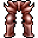 | **Plate Legs (G)** | 7 | – | – | 4.00 oz |
|  | **Ranger Legs** | 7 | – | – | 50.00 oz |
|  | **Bronze Plate Legs** | 6 | – | Physical +1% | 80.00 oz |
|  | **Bronze Ranger Legs** | 6 | Distance +1 | – | 50.00 oz |
|  | **Iron Wizard Legs** | 6 | Magic Level +1 Max HP +25 | – | 35.00 oz |
|  | **Ocean Legs** | 6 | – | – | 20.00 oz |
|  | **Wereboar Loincloth** | 6 | – | – | 13.00 oz |
|  | **Brass Legs** | 5 | – | – | 38.00 oz |
| 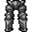 | **Brass Legs (G)** | 5 | – | – | 5.00 oz |
|  | **Bronze Wizard Legs** | 5 | Magic Level +1 | – | 30.00 oz |
|  | **Chain Legs** | 3 | – | – | 35.00 oz |
|  | **Chain Legs (G)** | 3 | – | – | 3.00 oz |
|  | **Studded Legs** | 2 | – | – | 26.00 oz |
|  | **Studded Legs (G)** | 2 | – | – | 6.00 oz |
|  | **Tatty Dragon Scale Legs** | 2 | – | – | 38.00 oz |
|  | **Leather Legs** | 1 | – | – | 18.00 oz |
|  | **Pirate Knee Breeches** | 1 | – | – | 12.00 oz |
|  | **Bast Skirt** | – | – | – | 3.50 oz |
|  | **Mammoth Fur Shorts** | 0 | – | – | 1.50 oz |



_55 items, sorted by Armor._

| | Item | Arm | Bonuses | Protection | Weight |
| - | - | - | - | - | - |
|  | **Zulmthu Boots** | 5 | Speed +30 Crit 2% Attack Speed +0.02s | Physical +5% | 42.00 oz |
|  | **Dragon Boots** | 4 | Speed +20 | – | 8.50 oz |
|  | **Golden Boots** | 4 | – | – | 31.00 oz |
| 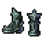 | **Gurukk Boots** | 4 | Speed +30 Crit 2% / +5% | Physical +5% | 20.00 oz |
|  | **Treader Of Torment** | 4 | Magic Level +3 Speed +15 | Physical +3% | 36.00 oz |
|  | **Adamant Plate Boots** | 3 | One-handed +3 Two-handed +3 | Physical +2% | 40.00 oz |
| 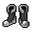 | **Angelic Boots** | 3 | Distance +2 Speed +40 Crit 3% / +3% +0.5 MP/s | – | 12.00 oz |
|  | **Cobra Boots** | 3 | Magic Level +1 Speed +5 | Physical +3% | 9.00 oz |
|  | **Crystal Boots** | 3 | – | Ice +3% Energy -3% | 18.50 oz |
|  | **Dragon Scale Boots** | 3 | – | Fire +3% Ice -3% | 18.50 oz |
|  | **Draken Boots** | 3 | Speed +15 | – | 25.00 oz |
| 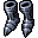 | **Guardian Boots** | 3 | – | Physical +2% Holy -2% | 22.50 oz |
| 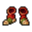 | **Kakdrak Boots** | 3 | Magic Level +4 Speed +35 Life Leech 4% / 4% +0.5 MP/s | Fire +5% Death +5% | 25.00 oz |
|  | **Obsidian Boots** | 3 | Magic Level +2 Speed +10 | Physical +2% Death +3% Holy -3% | 36.00 oz |
|  | **Prismatic Boots** | 3 | One-handed +3 Two-handed +3 Speed +15 | – | 18.00 oz |
|  | **Rune Plate Boots** | 3 | One-handed +4 Two-handed +4 Speed +20 +3.0 HP/s | Physical +3% | 37.00 oz |
|  | **Steel Boots** | 3 | – | – | 29.00 oz |
|  | **Undergrowth Boots** | 3 | Magic Level +2 Speed +35 | Earth +6% | 6.00 oz |
| 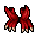 | **Vitality Boots** | 3 | Max HP +90 | – | 27.00 oz |
|  | **Adamant Ranger Boots** | 2 | Distance +3 | Physical +2% | 30.00 oz |
|  | **Adamant Wizard Boots** | 2 | Magic Level +3 Speed +20 Max HP +60 | – | 33.00 oz |
| 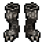 | **Badger Boots** | 2 | Speed +10 | – | 12.00 oz |
|  | **Fur Boots** | 2 | Speed +-6 | – | 12.00 oz |
|  | **Glacier Shoes** | 2 | – | Ice +5% Energy -5% | 7.50 oz |
|  | **Golden Plate Boots** | 2 | One-handed +1 Two-handed +1 | Physical +1% | 40.00 oz |
| 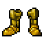 | **Golden Ranger Boots** | 2 | Distance +2 | Physical +1% | 50.00 oz |
|  | **Golden Wizard Boots** | 2 | Magic Level +1 Speed +20 Max HP +30 | – | 34.00 oz |
| 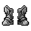 | **Iron Plate Boots** | 2 | – | Physical +1% | 50.00 oz |
| 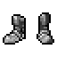 | **Iron Ranger Boots** | 2 | Distance +1 | – | 45.00 oz |
|  | **Lightning Boots** | 2 | – | Energy +5% Earth -5% | 7.50 oz |
| 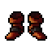 | **Magma Boots** | 2 | – | Fire +5% Ice -5% | 7.50 oz |
| 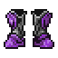 | **Mithril Plate Boots** | 2 | One-handed +2 Two-handed +2 | Physical +2% | 50.00 oz |
| 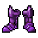 | **Mithril Ranger Boots** | 2 | Distance +2 | Physical +2% | 49.00 oz |
|  | **Mithril Wizard Boots** | 2 | Magic Level +2 Speed +20 Max HP +40 | – | 40.00 oz |
|  | **Oriental Shoes** | 2 | Speed +15 | – | 5.00 oz |
|  | **Pair Of Dreamwalkers** | 2 | Magic Level +3 Speed +30 +0.5 MP/s | – | 8.00 oz |
|  | **Patched Boots** | 2 | Speed +25 | – | 10.00 oz |
|  | **Pirate Boots** | 2 | – | – | 8.00 oz |
|  | **Rune Ranger Boots** | 2 | Distance +4 Speed +20 +2.0 HP/s +1.0 MP/s | All Elements +2% | 28.00 oz |
|  | **Rune Wizard Boots** | 2 | Magic Level +4 Speed +25 Max HP +100 +1.0 MP/s | – | 30.00 oz |
|  | **Terra Boots** | 2 | – | Fire -5% Earth +5% | 7.50 oz |
| 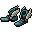 | **Winged Boots** | 2 | Magic Level +2 Distance +2 Speed +35 | Earth +7% | 12.00 oz |
| 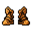 | **Bronze Plate Boots** | 1 | – | Physical +1% | 40.00 oz |
| 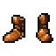 | **Bronze Ranger Boots** | 1 | Distance +1 | – | 40.00 oz |
|  | **Bronze Wizard Boots** | 1 | Magic Level +1 | – | 26.00 oz |
|  | **Crocodile Boots** | 1 | – | – | 9.00 oz |
|  | **Iron Wizard Boots** | 1 | Magic Level +1 Max HP +25 | – | 30.00 oz |
|  | **Leather Boots** | 1 | – | – | 9.00 oz |
|  | **Zaoan Shoes** | 1 | Speed +5 | – | 7.00 oz |
|  | **Boots Of Haste** | – | Speed +20 | – | 7.50 oz |
|  | **Boots Of Haste (G)** | – | Speed +20 | – | 2.00 oz |
|  | **Boots Of Strong Haste** | – | Speed +40 | – | 7.50 oz |
|  | **Bunnyslippers** | – | – | – | 6.80 oz |
|  | **Ranger Boots** | – | Distance +3 | – | 4.00 oz |
| 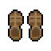 | **Sandals** | – | – | – | 6.00 oz |



_97 items, sorted by Defense._

| | Item | Def | Arm | Bonuses | Protection | Weight |
| - | - | - | - | - | - | - |
|  | **Aurora Shield** | 50 | – | Magic Level +3 | Physical -20% Life Drain +15% Mana Drain +15% All Elements +10% | 44.00 oz |
|  | **Zulmthu Shield** _Can only be wielded by knights level 250+_ | 44 | – | One-handed +5 Max HP +320 Crit 3% Attack Speed +0.05s | Physical +7% | 78.00 oz |
|  | **Retro Great Shield** _Made of dragon scales_ | 42 | – | Speed +10 | Fire +12% Ice -7% | 32.00 oz |
|  | **Blessed Shield** | 40 | – | – | – | 68.00 oz |
|  | **Falcon Escutcheon** | 40 | – | – | Physical +6% Fire +12% | 60.00 oz |
|  | **Vitality Shield** | 40 | – | Max HP +300 | – | 80.00 oz |
|  | **Falcon Shield** | 39 | – | – | Physical +4% Fire +8% | 57.00 oz |
|  | **Death Gaze** | 38 | – | – | – | 79.00 oz |
|  | **Gnome Shield** | 38 | – | Shielding +2 | Physical +6% Ice -6% Energy +8% Earth -4% | 60.00 oz |
|  | **Great Shield** | 38 | – | – | – | 84.00 oz |
|  | **Rune Kite Shield** | 38 | – | One-handed +4 Shielding +4 | All Elements +3% | 58.00 oz |
|  | **Ectoplasmic Shield** | 37 | – | One-handed +3 | Fire -7% Ice +7% Energy -7% Earth +7% Life Drain +10% | 58.00 oz |
|  | **Mastermind Shield** | 37 | – | – | – | 57.00 oz |
|  | **Necromancer Shield** | 37 | – | – | – | 32.00 oz |
|  | **Nightmare Shield** _Crafted by the ancient order of Nightmare Knights_ | 37 | – | Speed +20 Life Leech 5% / 5% | Life Drain +5% Mana Drain +5% | 32.00 oz |
|  | **Rift Shield** | 37 | – | – | – | 65.00 oz |
|  | **Shield Of Death** | 37 | – | – | Life Drain +10% | 64.00 oz |
|  | **Carapace Shield** | 36 | – | – | – | 55.00 oz |
|  | **Mithril Kite Shield** | 36 | – | One-handed +2 Shielding +2 | Physical +2% | 65.00 oz |
|  | **Retro Mastermind Shield** | 36 | – | – | – | 55.00 oz |
|  | **Shield Of Corruption** | 36 | – | One-handed +3 | Fire +7% | 49.00 oz |
|  | **Tempest Shield** | 36 | – | – | – | 51.00 oz |
|  | **Demon Shield** | 35 | – | – | – | 26.00 oz |
|  | **Demon Shield (G)** | 35 | – | – | – | 2.00 oz |
|  | **Golden Kite Shield** | 34 | – | One-handed +1 Shielding +2 | Physical +2% | 69.00 oz |
|  | **Haunted Mirror Piece** | 34 | – | – | – | 28.00 oz |
|  | **Ornate Shield** | 34 | – | – | Physical +4% | 71.00 oz |
|  | **Phoenix Shield** | 34 | – | – | – | 35.00 oz |
|  | **Vampire Shield** | 34 | – | – | – | 38.00 oz |
|  | **Mastermind Shield (G)** | 33 | – | – | – | 6.00 oz |
|  | **Medusa Shield** | 33 | – | – | – | 58.00 oz |
|  | **Shield Of Honour** | 33 | – | – | – | 54.00 oz |
|  | **Warrior'S Shield** | 33 | – | – | – | 75.00 oz |
|  | **Amazon Shield** | 32 | – | – | – | 62.00 oz |
|  | **Crown Shield** | 32 | – | – | – | 62.00 oz |
|  | **Eagle Shield** | 32 | – | – | – | 62.00 oz |
|  | **Iron Kite Shield** | 32 | – | Shielding +2 | Physical +1% | 60.00 oz |
|  | **Retro Crown Shield** | 32 | – | – | – | 55.00 oz |
|  | **Tower Shield** | 32 | – | – | – | 82.00 oz |
|  | **Dragon Shield** | 31 | – | – | – | 60.00 oz |
|  | **Retro Dragon Shield** | 31 | – | – | – | 55.00 oz |
|  | **Runic Ice Shield** | 31 | – | – | – | 49.00 oz |
|  | **Guardian Shield** | 30 | – | – | – | 55.00 oz |
|  | **Rainbow Shield** | 30 | – | +0.5 HP/s +0.5 MP/s | – | 69.00 oz |
|  | **Bronze Kite Shield** | 29 | – | Shielding +1 | Physical +1% | 55.00 oz |
|  | **Griffin Shield** | 29 | – | – | – | 50.00 oz |
|  | **Beholder Shield** | 28 | – | – | – | 47.00 oz |
|  | **Castle Shield** | 28 | – | – | – | 49.00 oz |
|  | **Norse Shield** | 28 | – | – | – | 41.00 oz |
|  | **Obsidian Spellbinder** _Sorcerers and Druids lvl 150+ only_ | 28 | – | Magic Level +4 | Physical +4% Death +8% Holy -8% | 22.00 oz |
|  | **Spike Shield** | 28 | – | – | – | 59.00 oz |
|  | **Ancient Shield** | 27 | – | – | – | 61.00 oz |
|  | **Tusk Shield** | 27 | – | – | – | 69.00 oz |
|  | **Dwarven Shield** | 26 | – | – | – | 55.00 oz |
|  | **Retro Dwarven Shield** | 26 | – | – | – | 55.00 oz |
|  | **Salamander Shield** | 26 | – | – | – | 59.00 oz |
|  | **Shoulder Plate** | 26 | – | Magic Level +5 Earth damage +3% | Physical +4% Earth +6% | 35.00 oz |
|  | **Tortoise Shield** | 26 | – | – | – | 52.00 oz |
|  | **Dark Shield** | 25 | – | – | – | 52.00 oz |
|  | **Depth Scutum** | 25 | – | Magic Level +2 | Physical +2% | 30.00 oz |
|  | **Scarab Shield** | 25 | – | – | – | 47.00 oz |
|  | **Rune Spellbook** | 24 | – | Magic Level +4 Max HP +100 | All Elements +4% | 28.00 oz |
|  | **Battle Shield** | 23 | – | – | – | 62.00 oz |
|  | **Ornamented Shield** | 22 | – | – | – | 67.00 oz |
|  | **Sentinel Shield** | 22 | – | – | – | 49.00 oz |
|  | **Spellbook Of Warding** | 22 | – | Magic Level +1 | – | 21.00 oz |
|  | **Viking Shield** | 22 | – | – | – | 66.00 oz |
|  | **Steel Shield** | 21 | – | – | – | 69.00 oz |
|  | **Steel Shield (G)** | 21 | – | – | – | 6.00 oz |
|  | **Bone Shield** | 20 | – | – | – | 55.00 oz |
|  | **Mithril Spellbook** | 20 | – | Magic Level +3 Max HP +40 | – | 32.00 oz |
|  | **Spellbook Of Lost Souls** | 20 | – | Magic Level +2 | – | 25.60 oz |
|  | **Spellbook Of Soul Steal** _Sorcerers and Druids lvl 250+ only, Faster mana regen, Life leech amount +5%, Life leech chance +5%_ | 20 | – | Magic Level +6 Life Leech 5% / 5% +0.5 MP/s | Physical +5% Death +8% | 17.00 oz |
|  | **Spellbook Of Vigilance** | 20 | – | Magic Level +3 | Fire -3% Earth +3% | 27.00 oz |
|  | **Umbral Master Spellbook** _Sorcerers and Druids only_ | 20 | – | Magic Level +4 | Fire +5% Ice +5% Energy +5% Earth +5% | 30.00 oz |
|  | **Brain In A Jar** | 19 | – | Magic Level +3 | Earth +10% | 27.00 oz |
|  | **Copper Shield** | 19 | – | – | – | 63.00 oz |
|  | **Retro Copper Shield** | 19 | – | – | – | 55.00 oz |
|  | **Spellbook Of Ancient Arcana** _Sorcerers and Druids only, Shows spells, Shields attacks_ | 19 | – | Magic Level +4 | Physical +3% Death +5% | 25.00 oz |
|  | **Black Shield** | 18 | – | – | – | 42.00 oz |
|  | **Book Of Lies** _Sorcerers and Druids only_ | 18 | – | Magic Level +5 Max HP +150 | Physical +3% | 24.00 oz |
|  | **Golden Spellbook** | 18 | – | Magic Level +2 Max HP +30 | – | 29.00 oz |
|  | **Spellbook Of Enlightenment** | 18 | – | Magic Level +1 | – | 19.50 oz |
|  | **Iron Spellbook** | 17 | – | Magic Level +2 Max HP +25 | – | 24.00 oz |
|  | **Plate Shield** | 17 | – | – | – | 65.00 oz |
|  | **Spirit Guide** | 17 | – | Magic Level +5 Energy damage +3% | Physical +4% Energy +6% | 18.00 oz |
|  | **Brass Shield** | 16 | – | – | – | 60.00 oz |
|  | **Bronze Spellbook** | 16 | – | Magic Level +1 | – | 24.00 oz |
|  | **Spellbook Of Dark Mysteries** _Sorcerers and Druids only, Shows spells, Shields attacks_ | 16 | – | Magic Level +3 | – | 28.50 oz |
|  | **Spellbook Of Mind Control** | 16 | – | Magic Level +2 | – | 24.50 oz |
|  | **Umbral Spellbook** | 16 | – | Magic Level +2 | Fire +3% Ice +3% Energy +3% Earth +3% | 35.00 oz |
|  | **Wooden Spellbook** | 16 | – | Magic Level +2 | Earth +5% | 12.00 oz |
|  | **Studded Shield** | 15 | – | – | – | 59.00 oz |
|  | **Crude Umbral Spellbook** | 14 | – | Magic Level +1 | Fire +2% Ice +2% Energy +2% Earth +2% | 40.00 oz |
|  | **Snake God'S Wristguard** _Sorcerers and Druids only, Shows spells, Shields attacks_ | 14 | – | Magic Level +3 | – | 28.00 oz |
|  | **Wooden Shield** | 14 | – | – | – | 40.00 oz |
|  | **Spellscroll Of Prophecies** _Sorcerers and Druids only, Shows spells, Shields attacks_ | 12 | – | Magic Level +3 | – | 26.50 oz |



_144 items, sorted by Attack._

| | Item | Atk | Def | Bonuses | Weight |
| - | - | - | - | - | - |
|  | **Ice Rapier** | 100 | 1 | 1 charge | 15.00 oz |
|  | **Soul Longsword** _Level 200+ Obtainable from Frosthaven boss “Kakdrak”_ | 54 | 30 | Life Leech 12% / 12% Attack Speed +0.15s | 24.50 oz |
| 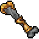 | **Mortal Mace** | 8 + 45 earth | 27 +2 | One-handed +3 | 41.00 oz |
|  | **Umbral Master Axe** | 53 | 30 +3 | One-handed +1 | 80.00 oz |
|  | **Zulmthu Axe** _Level 200+ Obtainable from Frosthaven boss “Zulmthu” Can only be wielded properly by knights_ | 53 | 36 | One-handed +10 Attack Speed +0.20s | 30.00 oz |
|  | **Axe Of Destruction** | 52 | 20 | One-handed +4 | 50.00 oz |
|  | **Cobra Axe** | 8 + 44 ice | 29 +2 | One-handed +2 Attack Speed +0.10s | 40.00 oz |
|  | **Impaler Of The Igniter** | 26 + 26 fire | 31 +3 | – | 59.00 oz |
|  | **Obsidian Axe** _Level 150+ Obtainable from boss “Infernatil”_ | 52 | 25 | One-handed +5 | 110.00 oz |
|  | **Plague Bite** | 26 + 26 earth | 31 +3 | – | 99.00 oz |
|  | **Resizer** | 4 + 48 ice | 40 | One-handed +3 | 89.00 oz |
|  | **Rune Cutlass** | 52 | 30 | One-handed +4 Crit 3% / +3% Attack Speed +0.15s | 47.00 oz |
|  | **The Epiphany** | 52 | 35 +3 | One-handed +5 Crit 2% | 45.00 oz |
|  | **The Revelation** | 52 | 29 +3 | One-handed +5 Crit damage +2% | 110.00 oz |
|  | **Thunder Hammer** | 4 + 48 energy | 35 | One-handed +4 | 125.00 oz |
| 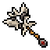 | **Umbral Master Mace** | 52 | 30 +3 | One-handed +1 | 80.00 oz |
|  | **Umbral Masterblade** | 52 | 31 +3 | One-handed +1 | 55.00 oz |
|  | **Blade Of Destruction** | 51 | 33 | One-handed +4 Attack Speed +0.10s | 50.00 oz |
| 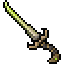 | **Cobra Sword** | 51 | 31 +2 | One-handed +2 Attack Speed +0.10s | 63.00 oz |
|  | **Crystalline Axe** | 51 | 29 +3 | One-handed +1 Crit damage +1% | 76.00 oz |
|  | **Dark Trinity Mace** | 15 + 36 death | 32 -1 | One-handed +2 | 99.00 oz |
|  | **Hellforged Axe** | 51 | 28 +2 | – | 88.00 oz |
| 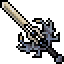 | **Obsidian Sword** | 51 | 30 | One-handed +5 Attack Speed +0.10s | 35.00 oz |
|  | **Shiny Blade** | 51 | 35 +3 | One-handed +2 Attack Speed +0.10s | 45.00 oz |
|  | **Summerblade** | 6 + 45 fire | 20 +4 | One-handed +4 | 43.00 oz |
|  | **Umbral Axe** | 51 | 27 +2 | – | 85.00 oz |
|  | **Winterblade** | 6 + 45 ice | 22 +4 | One-handed +4 | 43.00 oz |
|  | **Demonbone** | 50 | 38 -5 | One-handed +1 | 180.00 oz |
|  | **Emerald Sword** | 50 | 33 +3 | One-handed +1 Attack Speed +0.07s | 41.00 oz |
| 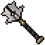 | **Falcon Mace** | 7 + 43 energy | 33 +3 | One-handed +3 | 68.00 oz |
|  | **Mycological Mace** | 50 | 31 +3 | One-handed +3 | 59.00 oz |
|  | **Obsidian Hammer** | 50 | 38 | One-handed +5 | 35.00 oz |
| 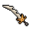 | **Umbral Blade** | 50 | 29 +2 | – | 59.00 oz |
| 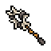 | **Umbral Mace** | 50 | 26 +2 | – | 85.00 oz |
|  | **Adamant Cutlass** | 49 | 27 | One-handed +3 Attack Speed +0.15s | 49.00 oz |
| 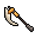 | **Crude Umbral Axe** | 49 | 24 +1 | – | 90.00 oz |
|  | **Impaler** | 49 | 25 -2 | One-handed +2 | 82.00 oz |
|  | **Obsidian Truncheon** | 49 | 30 +2 | – | 65.00 oz |
| 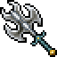 | **Ornate Mace** | 49 | 24 | – | 149.00 oz |
|  | **Blade Of Corruption** | 48 | 29 +2 | – | 64.00 oz |
| 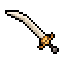 | **Crude Umbral Blade** | 48 | 26 +1 | – | 63.00 oz |
| 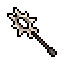 | **Crude Umbral Mace** | 48 | 22 +1 | – | 90.00 oz |
| 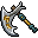 | **Deepling Axe** | 48 | 29 | – | 91.00 oz |
|  | **Dragon Dagger** | 48 | 36 | One-handed +3 Attack Speed +0.20s | 24.50 oz |
|  | **Jade Hammer** | 48 | 27 +1 | – | 32.00 oz |
|  | **Mythril Axe** | 48 | 28 +2 | – | 55.00 oz |
|  | **Snake God'S Sceptre** | 48 | 29 +3 | – | 120.00 oz |
| 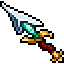 | **Crystalline Sword** | 47 | 34 +1 | – | 48.00 oz |
|  | **Royal Axe** | 47 | 25 +3 | – | 92.00 oz |
| 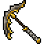 | **Hive Scythe** | 46 | 24 | – | 75.00 oz |
| 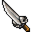 | **Nightmare Blade** | 46 | 23 -3 | – | 46.00 oz |
|  | **Reaper'S Axe** | 46 | 25 +2 | – | 59.00 oz |
|  | **Mithril Cutlass** | 45 | 26 | One-handed +3 Attack Speed +0.10s | 55.00 oz |
| 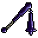 | **Onyx Flail** | 45 | 18 | – | 26.00 oz |
|  | **Ravenwing** | 45 | 22 +1 | – | 55.00 oz |
|  | **Runed Sword** | 45 | 32 +2 | – | 46.00 oz |
|  | **Cranial Basher** | 44 | 20 -2 | – | 78.00 oz |
|  | **Deepling Squelcher** | 44 | 28 | – | 89.00 oz |
|  | **Mystic Blade** | 44 | 25 +2 | – | 35.00 oz |
|  | **Bloody Edge** | 43 | 21 -3 | – | 52.00 oz |
|  | **Queen'S Sceptre** | 43 | 19 | – | 23.00 oz |
|  | **Vile Axe** | 43 | 19 +3 | – | 52.00 oz |
|  | **Zaoan Sword** | 43 | 18 +2 | – | 49.00 oz |
| 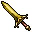 | **Golden Cutlass** | 42 | 24 | One-handed +2 | 50.00 oz |
| 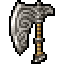 | **Ornamented Axe** | 42 | 22 +2 | – | 61.50 oz |
|  | **Relic Sword** | 42 | 24 +1 | – | 48.00 oz |
| 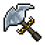 | **Warrior'S Axe** | 42 | 21 | – | 88.00 oz |
|  | **Butcher'S Axe** | 41 | 24 -2 | – | 63.00 oz |
|  | **Pharaoh Sword** | 41 | 23 | – | 52.00 oz |
|  | **Silver Mace** | 41 | 30 | – | 67.00 oz |
| 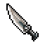 | **Assassin Dagger** | 40 | 12 -2 | – | 17.00 oz |
|  | **Dreaded Cleaver** | 40 | 19 -3 | – | 38.00 oz |
|  | **Noble Axe** | 39 | 22 | – | 38.00 oz |
|  | **Shadow Sceptre** | 39 | 17 | – | 41.00 oz |
|  | **Crystal Mace** | 38 | 16 | – | 80.00 oz |
|  | **Djinn Blade** | 38 | 22 | – | 24.50 oz |
|  | **Fire Axe** | 27 + 11 fire | 16 | – | 40.00 oz |
|  | **Fire Axe (S)** | 38 | 16 | – | 40.00 oz |
|  | **Epee** | 37 | 23 | – | 14.50 oz |
| 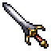 | **Iron Cutlass** | 37 | 22 | One-handed +2 | 48.00 oz |
|  | **Sapphire Hammer** | 37 | 18 | – | 21.00 oz |
| 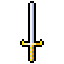 | **Bright Sword** | 36 | 30 | – | 29.00 oz |
|  | **Skull Staff** | 36 | 12 | – | 17.00 oz |
|  | **Skull Staff (S)** | 36 | 12 | – | 17.00 oz |
|  | **Beastslayer Axe** | 35 | 12 | – | 61.50 oz |
|  | **Dragonbone Staff** | 35 | 18 | – | 18.00 oz |
|  | **Fire Sword** | 24 + 11 fire | 20 | – | 23.00 oz |
|  | **Fire Sword (S)** | 35 | 20 | – | 23.00 oz |
|  | **Sword Of Fury** | 35 | 23 +1 | – | 20.00 oz |
|  | **Bronze Cutlass** | 34 | 22 | One-handed +1 | 46.00 oz |
|  | **Diamond Sceptre** | 34 | 18 | – | 15.00 oz |
|  | **Knight Axe** | 33 | 21 | – | 59.00 oz |
|  | **Dragon Hammer** | 32 | 20 | – | 55.00 oz |
|  | **Fiery Clerical Mace** | 16 + 16 fire | 15 +1 | – | 58.00 oz |
|  | **Wyvern Fang** | 32 | 19 +1 | – | 20.00 oz |
|  | **Dwarven Axe** | 31 | 19 | – | 82.00 oz |
|  | **Furry Club** | 31 | 19 +1 | – | 42.00 oz |
|  | **Spiky Club** | 31 | 14 | – | 39.00 oz |
|  | **Mammoth Whopper** | 30 | 15 | – | 45.00 oz |
|  | **Barbarian Axe** | 28 | 18 | – | 51.00 oz |
|  | **Clerical Mace** | 28 | 15 | – | 58.00 oz |
|  | **Crimson Sword** | 28 | 20 +1 | – | 36.00 oz |
|  | **Life Preserver** | 27 | 19 +2 | – | 46.00 oz |
|  | **Ratana** | 27 | 19 +1 | – | 33.00 oz |
|  | **Serpent Sword** | 26 | 15 | – | 41.00 oz |
|  | **Banana Staff** | 25 | 15 | – | 50.00 oz |
|  | **Morning Star** | 25 | 11 | – | 30.00 oz |
|  | **Battle Hammer** | 24 | 14 | – | 68.00 oz |
|  | **Icy Spike Sword** | 20 + 4 ice | 21 +2 | 1000 charges | 50.00 oz |
|  | **Spike Sword** | 24 | 21 | – | 50.00 oz |
|  | **Orcish Axe** | 23 | 12 | – | 45.00 oz |
|  | **Templar Scytheblade** | 23 | 15 | – | 29.00 oz |
|  | **Daramian Mace** | 21 | 12 | – | 68.00 oz |
|  | **Scimitar** | 19 | 13 | – | 29.00 oz |
|  | **Iron Hammer** | 18 | 10 | – | 66.00 oz |
|  | **Poison Dagger** | 18 | 8 | – | 8.80 oz |
|  | **Longsword** | 17 | 14 | – | 42.00 oz |
|  | **Swampling Club** | 17 | 12 | – | 31.00 oz |
|  | **Heavy Machete** | 16 | 10 | – | 18.40 oz |
|  | **Katana** | 16 | 12 | – | 31.00 oz |
|  | **Mace** | 16 | 11 | – | 38.00 oz |
|  | **Carlin Sword** | 15 | 13 | – | 40.00 oz |
|  | **Hatchet** | 15 | 8 | – | 35.00 oz |
|  | **Bone Sword** | 14 | 10 | – | 19.00 oz |
|  | **Sword** | 14 | 12 | – | 35.00 oz |
|  | **Golden Sickle** | 13 | 6 | – | 19.50 oz |
|  | **Axe** | 12 | 6 | – | 40.00 oz |
|  | **Bone Club** | 12 | 8 | – | 39.00 oz |
|  | **Machete** | 12 | 9 | – | 16.50 oz |
|  | **Ron The Ripper'S Sabre** | 12 | 10 | – | 25.00 oz |
|  | **Sabre** | 12 | 10 | – | 25.00 oz |
|  | **Short Sword** | 11 | 11 | – | 35.00 oz |
|  | **Hand Axe** | 10 | 5 | – | 18.00 oz |
|  | **Rapier** | 10 | 8 | – | 15.00 oz |
|  | **Silver Dagger** | 9 | 7 | – | 10.20 oz |
|  | **Studded Club** | 9 | 8 | – | 35.00 oz |
|  | **Combat Knife** | 8 | 6 | – | 8.70 oz |
|  | **Dagger** | 8 | 6 | – | 9.50 oz |
|  | **Club** | 7 | 7 | – | 25.00 oz |
|  | **Crowbar** | 5 | 6 | – | 21.00 oz |
|  | **Knife** | 5 | 5 | – | 4.20 oz |
|  | **Sickle** | 5 | 4 | – | 10.50 oz |
|  | **Wooden Sword** | 4 | 1 | – | 10.00 oz |
|  | **Light Mace** | 1 | 9 | – | 41.00 oz |



_101 items, sorted by Attack._

| | Item | Atk | Def | Bonuses | Weight |
| - | - | - | - | - | - |
|  | **Gurukk Godsword** _Level 200+ Obtainable from Frosthaven boss “Gurukk”_ | 70 | 15 | Crit 5% / +5% | 80.00 oz |
|  | **Kakdrak Godsword** _Level 200+ Obtainable from Frosthaven boss “Kakdrak”_ | 35 + 35 fire | 15 | Crit 5% / +5% | 80.00 oz |
|  | **Zephon Godsword** _Level 200+ Obtainable from Frosthaven boss “Zephon”_ | 35 + 35 energy | 15 | Crit 5% / +5% | 80.00 oz |
|  | **Zulmthu Godsword** _Level 200+ Obtainable from Frosthaven boss “Zulmthu”_ | 35 + 35 ice | 15 | Crit 5% / +5% | 80.00 oz |
|  | **Dragon Greatsword** | 64 | 15 | Two-handed +4 Attack Speed +0.20s | 80.00 oz |
|  | **Hydra Greatsword** | 64 | 15 | Two-handed +3 Attack Speed +0.20s | 80.00 oz |
|  | **Venomous Lance** | 64 | 13 | – | 60.00 oz |
|  | **Chopper Of Destruction** | 62 | 33 | Two-handed +4 Crit damage +2% | 70.00 oz |
|  | **Obsidian Great Axe** _Level 150+ Obtainable from boss “Infernatil”_ | 62 | 14 | Two-handed +4 | 150.00 oz |
|  | **Slayer Of Destruction** | 62 | 20 | Two-handed +4 Crit 2% | 70.00 oz |
|  | **Tagralt Blade** | 5 + 56 earth | 34 | Two-handed +4 | 81.00 oz |
|  | **Falcon Battleaxe** | 13 + 47 energy | 17 | Two-handed +4 | 95.00 oz |
|  | **Phantasmal Axe** | 4 + 56 fire | 30 | Two-handed +1 | 72.00 oz |
|  | **Rune Double Axe** | 60 | 15 | Two-handed +4 Crit 3% / +3% Attack Speed +0.15s | 107.00 oz |
|  | **Ancient Mace** | 59 | 28 | Two-handed +3 Attack Speed +0.10s | 100.00 oz |
|  | **Demonwing Axe** | 59 | 11 | Two-handed +4 Attack Speed +0.10s | 120.00 oz |
|  | **Falcon Longsword** | 59 | 16 | Two-handed +3 | 82.00 oz |
|  | **Underworld Axe** | 59 | 14 | Two-handed +3 | 75.00 oz |
|  | **Adamant Double Axe** | 57 | 14 | Two-handed +3 Attack Speed +0.15s | 110.00 oz |
|  | **Great Axe** | 57 | 15 | Two-handed +1 | 90.00 oz |
|  | **Underworld Sword** | 57 | 14 | Two-handed +3 | 90.00 oz |
|  | **Executioner** | 56 | 10 | Two-handed +4 Physical damage +2% | 99.00 oz |
|  | **Skullcrusher** | 56 | 10 | Two-handed +4 Physical damage +2% | 120.00 oz |
|  | **The Calamity** | 56 | 17 | Two-handed +4 Physical damage +2% | 68.00 oz |
|  | **Umbral Master Hammer** | 55 | 34 | One-handed +3 | 160.00 oz |
|  | **Hammer Of Prophecy** | 54 | 17 | Two-handed +1 | 110.00 oz |
|  | **Mithril Double Axe** | 54 | 14 | Two-handed +2 Attack Speed +0.10s | 100.00 oz |
|  | **The Stomper** | 54 | 10 | Two-handed +2 | 115.00 oz |
|  | **Umbral Master Chopper** | 54 | 34 | One-handed +3 | 110.00 oz |
|  | **Umbral Master Slayer** | 54 | 35 | One-handed +3 | 90.00 oz |
|  | **Arcane Staff** | 53 | 16 | Two-handed +1 | 40.00 oz |
|  | **Ruthless Axe** | 53 | 5 | – | 58.00 oz |
|  | **The Avenger** _Pits of Inferno Quest_ | 53 | 15 | Two-handed +1 | 64.00 oz |
|  | **Umbral Hammer** | 53 | 30 | – | 165.00 oz |
|  | **Fire Hammer** | 32 + 20 fire | 5 | – | 75.00 oz |
|  | **Havoc Blade** | 52 | 16 | – | 72.00 oz |
|  | **Ravager'S Axe** | 52 | 10 | – | 52.50 oz |
|  | **Umbral Chopper** | 52 | 30 | – | 115.00 oz |
|  | **Umbral Slayer** | 52 | 31 | – | 95.00 oz |
|  | **Crude Umbral Chopper** | 51 | 27 | – | 120.00 oz |
|  | **Crude Umbral Hammer** | 51 | 27 | – | 170.00 oz |
|  | **Crude Umbral Slayer** | 51 | 29 | – | 100.00 oz |
|  | **Golden Double Axe** | 51 | 14 | Two-handed +2 | 110.00 oz |
|  | **Heavy Mace** | 51 | 10 | Two-handed +1 | 110.00 oz |
|  | **Rift Lance** | 51 | 14 | – | 66.00 oz |
|  | **Abyss Hammer** | 50 | 11 | – | 55.00 oz |
|  | **Hammer Of Wrath** | 50 | 10 | – | 70.00 oz |
|  | **Retro Giant Sword** | 50 | 14 | – | 100.00 oz |
|  | **War Axe** | 50 | 10 | – | 61.50 oz |
|  | **Berserker** | 49 | 10 | Two-handed +1 | 130.00 oz |
|  | **Demonrage Sword** | 49 | 10 | Two-handed +1 | 150.00 oz |
|  | **Dragon Lance** | 49 | 8 | – | 67.00 oz |
|  | **Drakinata** | 49 | 10 | – | 54.00 oz |
|  | **Giant Sword (S)** | 49 | 15 | – | 90.00 oz |
|  | **Twiceslicer** | 49 | 15 | – | 180.00 oz |
|  | **Bonebreaker** | 48 | 8 | – | 120.00 oz |
|  | **Drachaku** | 48 | 12 | – | 60.00 oz |
|  | **Giant Sword** | 48 | 12 | – | 90.00 oz |
|  | **Guardian Axe** | 48 | 8 | – | 110.00 oz |
|  | **Guardian Halberd** | 48 | 10 | – | 110.00 oz |
|  | **Pair Of Iron Fists** | 48 | 12 | – | 45.00 oz |
|  | **Sai** | 48 | 13 | – | 50.00 oz |
|  | **Thaian Sword** | 48 | 15 | – | 61.00 oz |
|  | **Twin Axe** | 48 | 13 | – | 64.00 oz |
|  | **War Hammer** | 48 | 8 | – | 85.00 oz |
|  | **War Hammer (S)** | 48 | 8 | – | 85.00 oz |
|  | **Chaos Mace** | 47 | 11 | – | 63.00 oz |
|  | **Dragon Slayer** | 47 | 14 | – | 82.00 oz |
|  | **Ogre Klubba** | 47 | 13 | – | 79.00 oz |
|  | **Angelic Axe** | 46 | 12 | – | 56.00 oz |
|  | **Deepling Staff** | 46 | 13 | – | 88.00 oz |
|  | **Iron Double Axe** | 46 | 12 | Two-handed +2 | 95.00 oz |
|  | **Mercenary Sword** | 46 | 14 | – | 68.00 oz |
|  | **Amber Staff** | 45 | 12 | – | 35.00 oz |
|  | **Blacksteel Sword** | 45 | 12 | – | 59.00 oz |
|  | **Bronze Double Axe** | 45 | 10 | Two-handed +1 | 100.00 oz |
|  | **Headchopper** | 45 | 8 | – | 45.00 oz |
|  | **Titan Axe** | 45 | 15 | – | 81.00 oz |
|  | **Spiked Squelcher** | 44 | 11 | – | 68.00 oz |
|  | **Glorious Axe** | 43 | 13 | – | 95.00 oz |
|  | **Daramian Waraxe** | 42 | 11 | – | 52.50 oz |
|  | **Haunted Blade** | 42 | 6 | – | 31.00 oz |
|  | **Lunar Staff** | 42 | 12 | – | 38.00 oz |
|  | **Naginata** | 42 | 15 | – | 80.00 oz |
|  | **Ogre Choppa** | 41 | 13 | – | 75.00 oz |
|  | **Zaoan Halberd** | 39 | 10 | – | 87.00 oz |
|  | **Brutetamer'S Staff** | 38 | 5 | – | 38.00 oz |
|  | **Crystal Sword** | 38 | 14 | – | 69.00 oz |
|  | **Double Axe** | 38 | 8 | – | 70.00 oz |
|  | **Halberd** | 38 | 9 | – | 90.00 oz |
|  | **Heavy Trident** | 38 | 12 | – | 90.00 oz |
|  | **Obsidian Lance** | 37 | 7 | – | 80.00 oz |
|  | **Twin Hooks** | 34 | 11 | – | 50.00 oz |
|  | **Taurus Mace** | 32 | 10 | – | 51.00 oz |
|  | **Two Handed Sword** | 32 | 10 | – | 70.00 oz |
|  | **Ripper Lance** | 30 | 7 | – | 80.00 oz |
|  | **Broadsword** | 28 | 10 | – | 52.50 oz |
|  | **Battle Axe** | 27 | 8 | – | 50.00 oz |
|  | **Staff** | 12 | 25 | – | 38.00 oz |
|  | **Scythe** | 8 | 3 | – | 30.00 oz |
|  | **Wooden Two-Handed Sword** | 6 | 4 | – | 20.00 oz |



_71 items, sorted by Attack._

| | Item | Atk | Range | Ammo | Bonuses | Weight |
| - | - | - | - | - | - | - |
|  | **Assassin Star** | 65 | 5 | – | – | 2.00 oz |
|  | **Enchanted Spear** | 38 | 5 | – | – | 10.00 oz |
|  | **Royal Spear** | 35 | 5 | – | – | 15.00 oz |
|  | **Throwing Star** | 35 | 5 | – | – | 2.00 oz |
|  | **Hunting Spear** | 32 | 5 | – | – | 22.00 oz |
|  | **Throwing Knife** | 30 | 5 | – | – | 5.00 oz |
|  | **Viper Star** | 28 | 5 | – | – | 2.00 oz |
|  | **Spear** | 25 | 5 | – | – | 10.00 oz |
|  | **The Devileye** (two-handed) _Wielded by Paladins_ | 20 | 6 | bolt | Crit damage +2% Attack Speed +0.10s Hit +-15% | 55.00 oz |
|  | **Angelic Crossbow** (two-handed) _Level 200+ Obtainable from Frosthaven boss “Zephon” Wielded by Paladins_ | 10 | 6 | bolt | Distance +5 Attack Speed +0.20s Hit +6% | 35.00 oz |
|  | **Thorn Spitter** (two-handed) _Wielded by Paladins_ | 10 | 6 | bolt | Distance +4 Crit damage +1% Attack Speed +0.10s Hit +1% | 126.00 oz |
|  | **Doom Bow** (two-handed) | 9 | 7 | arrow | Attack Speed +0.10s Hit +1% | 55.00 oz |
|  | **Fang Crossbow** (two-handed) _Wielded by Paladins_ | 9 | 6 | bolt | Distance +5 Attack Speed +0.10s Hit +1% | 42.00 oz |
|  | **Magic Bow** (two-handed) _Level 250+ Obtainable from Frosthaven boss “Kakdrak”_ | 9 | 7 | arrow | Distance +7 Attack Speed +0.22s Hit +7% | 47.00 oz |
|  | **Umbral Master Crossbow** (two-handed) | 9 | 5 | bolt | Hit +4% | 120.00 oz |
|  | **Crossbow Of Destruction** (two-handed) | 8 | 6 | bolt | Distance +5 Attack Speed +0.10s Hit +1% | 65.00 oz |
|  | **Obsidian Crossbow** (two-handed) _Obtainable from boss “Infernatil” Wielded by Paladins_ | 8 | 6 | bolt | Distance +5 Attack Speed +0.07s Hit +1% | 39.00 oz |
|  | **Adamant Crossbow** (two-handed) | 7 | 6 | bolt | Distance +3 Attack Speed +0.15s Hit +1% | 80.00 oz |
|  | **Ancient Crossbow** (two-handed) | 7 | 6 | bolt | Distance +3 Attack Speed +0.10s Hit +3% | 44.00 oz |
|  | **Cobra Crossbow** (two-handed) _Wielded by Paladins_ | 7 | 6 | bolt | Distance +3 Hit +1% | 40.00 oz |
|  | **Obsidian Bow** (two-handed) | 7 | 7 | arrow | Distance +4 Fire damage +3% Hit +5% | 39.00 oz |
|  | **Rune Crossbow** (two-handed) | 7 | 6 | bolt | Distance +4 Crit 3% / +3% Attack Speed +0.15s Hit +1% | 75.00 oz |
|  | **Rift Crossbow** (two-handed) | 6 | 6 | bolt | Hit +1% | 130.00 oz |
|  | **Rune Bow** (two-handed) | 6 | 7 | arrow | Distance +4 Crit 3% / +3% Attack Speed +0.15s Hit +5% | 52.00 oz |
|  | **Umbral Crossbow** (two-handed) | 6 | 5 | bolt | Hit +2% | 125.00 oz |
|  | **Umbral Master Bow** (two-handed) | 6 | 7 | arrow | Hit +5% | 40.00 oz |
|  | **Adamant Bow** (two-handed) | 5 | 7 | arrow | Distance +3 Attack Speed +0.15s Hit +4% | 59.00 oz |
|  | **Ancient Bow** (two-handed) | 5 | 7 | arrow | Magic Level +2 Attack Speed +0.10s Hit +5% | 40.00 oz |
|  | **Bow Of Cataclysm** (two-handed) | 5 | 7 | arrow | Magic Level +2 Distance +2 Hit +4% | 47.00 oz |
|  | **Mithril Crossbow** (two-handed) | 5 | 6 | bolt | Distance +2 Attack Speed +0.10s Hit +1% | 78.00 oz |
|  | **Royal Crossbow** (two-handed) _Wielded by Paladins_ | 5 | 6 | bolt | Distance +2 Hit +1% | 120.00 oz |
|  | **Small Stone** | 5 | 5 | – | – | 3.60 oz |
|  | **Triple Bolt Crossbow** (two-handed) _Wielded by Paladins_ | 5 | 6 | bolt | Attack Speed +0.40s Hit +4% | 62.00 oz |
|  | **Arbalest** (two-handed) | 4 | 6 | bolt | Distance +3 Hit +5% | 95.00 oz |
|  | **Bow Of Destruction** (two-handed) | 4 | 7 | arrow | Magic Level +3 Crit 2% Attack Speed +0.15s Holy damage +2% Hit +6% | 65.00 oz |
|  | **Chain Bolter** (two-handed) _Wielded by Paladins_ | 4 | 6 | bolt | Hit +1% | 55.00 oz |
|  | **Crystal Crossbow** (two-handed) | 4 | 6 | bolt | Hit +3% | 84.00 oz |
|  | **Golden Crossbow** (two-handed) | 4 | 6 | bolt | Distance +2 Hit +1% | 70.00 oz |
|  | **Inferno Crossbow** (two-handed) | 4 | 6 | bolt | Hit +1% | 52.00 oz |
|  | **Mithril Bow** (two-handed) | 4 | 7 | arrow | Distance +2 Attack Speed +0.10s Hit +3% | 61.00 oz |
|  | **Mycological Bow** (two-handed) | 4 + 1 fire | 7 | arrow | Attack Speed +0.10s Hit +4% | 49.00 oz |
|  | **The Ironworker** (two-handed) _Wielded by Paladins_ | 4 | 6 | bolt | Distance +2 Hit +1% | 55.00 oz |
|  | **Umbral Bow** | 4 | 7 | arrow | Hit +5% | 45.00 oz |
|  | **Warsinger Bow** (two-handed) | 4 | 7 | arrow | Distance +3 Attack Speed +0.10s Hit +5% | 45.00 oz |
|  | **Composite Hornbow** (two-handed) | 3 | 7 | arrow | Distance +1 Attack Speed +0.05s Hit +2% | 52.00 oz |
|  | **Crude Umbral Crossbow** (two-handed) | 3 | 5 | bolt | Hit +1% | 130.00 oz |
|  | **Energy Bow** (two-handed) | 3 + 3 energy | 7 | arrow | Attack Speed +0.10s Hit +7% | 52.00 oz |
|  | **Falcon Bow** (two-handed) | 3 | 7 | arrow | Magic Level +2 Distance +2 Attack Speed +0.10s Fire damage +3% Hit +5% | 35.00 oz |
|  | **Golden Bow** (two-handed) | 3 | 7 | arrow | Distance +2 Hit +2% | 54.00 oz |
|  | **Inferno Bow** (two-handed) | 3 + 2 fire | 7 | arrow | Fire damage +2% Hit +1% | 52.00 oz |
|  | **Iron Crossbow** (two-handed) | 3 | 6 | bolt | Distance +1 Hit +1% | 48.00 oz |
|  | **Training Spear** | 3 | 7 | – | – | 10.00 oz |
|  | **Crude Umbral Bow** | 2 | 7 | arrow | Hit +5% | 50.00 oz |
|  | **Elethriel'S Elemental Bow** (two-handed) | 2 | 7 | arrow | Distance +2 Attack Speed +0.20s Physical damage +-3% Fire damage +3% Ice damage +3% Earth damage +3% Hit +7% | 44.00 oz |
|  | **Iron Bow** (two-handed) | 2 | 7 | arrow | Distance +2 Hit +2% | 39.00 oz |
|  | **Yol'S Bow** (two-handed) | 2 | 7 | arrow | Attack Speed +0.05s Physical damage +-2% Fire damage +2% Ice damage +2% Earth damage +2% Hit +10% | 35.00 oz |
|  | **Angelic Bow** (two-handed) | 1 + 3 holy | 7 | arrow | Magic Level +4 Distance +5 Attack Speed +0.15s Holy damage +5% Hit +5% | 25.00 oz |
|  | **Bow** (two-handed) | 1 | 7 | arrow | Hit +1% | 31.00 oz |
|  | **Bronze Bow** (two-handed) | 1 | 7 | arrow | Distance +1 Hit +1% | 31.00 oz |
|  | **Bronze Crossbow** (two-handed) | 1 | 6 | bolt | Distance +1 Hit +1% | 40.00 oz |
|  | **Crossbow** (two-handed) | 1 | 6 | bolt | Hit +1% | 40.00 oz |
|  | **Elvish Bow** (two-handed) | 1 | 7 | arrow | Hit +3% | 39.00 oz |
|  | **Fiery Bow** (two-handed) | 1 + 1 fire | 7 | arrow | Attack Speed +0.05s Fire damage +1% Hit +4% | 52.00 oz |
|  | **Hive Bow** (two-handed) | 1 + 1 earth | 7 | arrow | Attack Speed +0.05s Earth damage +1% Hit +5% | 46.00 oz |
|  | **Icicle Bow** (two-handed) | 1 + 1 ice | 7 | arrow | Ice damage +2% Hit +4% | 42.00 oz |
|  | **Modified Crossbow** (two-handed) | 1 | 6 | bolt | Hit +1% | 35.00 oz |
|  | **Ornate Crossbow** (two-handed) | 1 | 6 | bolt | Hit +2% | 91.00 oz |
|  | **Rift Bow** (two-handed) | 1 + 1 holy | 7 | arrow | Magic Level +1 Attack Speed +0.10s Hit +3% | 41.00 oz |
|  | **Silkweaver Bow** (two-handed) | 1 | 7 | arrow | Hit +5% | 22.00 oz |
|  | **Slime Bow** (two-handed) | 1 | 7 | arrow | Hit +3% | 20.00 oz |
|  | **Snowball** | 0 | 5 | – | – | 0.80 oz |



_50 items, sorted by Magic Level._

| | Item | Element | Range | Bonuses | Weight |
| - | - | - | - | - | - |
|  | **Wand Of The Stars** _Level 200+ Obtainable from Frosthaven boss “Zephon” Wielded by Sorcerers and Druids_ | yellowdart | 8 | Magic Level +7 Crit 3% / +3% | 15.00 oz |
|  | **Obsidian Wand** _Level 150+ Obtainable from Frosthaven boss “Infernatil” Wielded by Druids and Sorcerers_ | death | 6 | Magic Level +5 | 31.00 oz |
|  | **Ancient Wand** | energy | 5 | Magic Level +4 | 19.00 oz |
|  | **Rod Of Destruction** | ice | 4 | Magic Level +4 Crit 2% | 35.00 oz |
|  | **Rune Wand** | energy | 7 | Magic Level +4 Crit 3% / +3% Attack Speed +0.15s | 35.00 oz |
|  | **Wand Of Destruction** | energy | 4 | Magic Level +4 Crit 2% | 35.00 oz |
|  | **Adamant Wand** | energy | 7 | Magic Level +3 Attack Speed +0.15s | 45.00 oz |
|  | **Falcon Rod** _Wielded by Druids_ | energy | 5 | Magic Level +3 | 37.00 oz |
|  | **Falcon Wand** _Wielded by Sorcerers_ | energy | 5 | Magic Level +3 | 33.00 oz |
|  | **Golden Wand** | energy | 7 | Magic Level +3 | 47.00 oz |
|  | **Mithril Wand** | energy | 7 | Magic Level +3 Attack Speed +0.10s | 48.00 oz |
|  | **Deepling Ceremonial Dagger** | smallice | 6 | Magic Level +2 | 32.00 oz |
|  | **Iron Wand** | energy | 7 | Magic Level +2 | 40.00 oz |
|  | **Bronze Wand** | energy | 7 | Magic Level +1 | 27.00 oz |
|  | **Glacial Rod** | smallice | 5 | Magic Level +1 | 37.00 oz |
|  | **Muck Rod** | smallearth | 5 | Magic Level +1 | 37.00 oz |
|  | **Radiant Glacial Rod** | smallice | 5 | Magic Level +1 | 37.00 oz |
|  | **Radiant Wand Of Dimensions** | death | 5 | Magic Level +1 | 28.00 oz |
|  | **Wand Of Defiance** | energy | 5 | Magic Level +1 | 37.00 oz |
|  | **Wand Of Dimensions** | death | 5 | Magic Level +1 | 28.00 oz |
|  | **Wand Of Everblazing** | fire | 8 | Magic Level +1 | 37.00 oz |
|  | **Ember Staff** | fire | 5 | – | 14.00 oz |
|  | **Moonlight Rod** | energy | 5 | – | 21.00 oz |
|  | **Northwind Rod** | ice | 5 | – | 29.00 oz |
|  | **Ogre Scepta** | smallearth | 3 | – | 29.00 oz |
|  | **Quagmire Rod** | poison | 5 | – | 25.00 oz |
|  | **Radiant Moonlight Rod** | energy | 5 | – | 21.00 oz |
|  | **Radiant Tempest Rod** | energy | 5 | – | 27.00 oz |
|  | **Radiant Underworld Rod** | death | 5 | – | 29.00 oz |
|  | **Radiant Volcanic Rod** | fire | 5 | – | 23.00 oz |
|  | **Radiant Wand Of Cosmic Energy** | energy | 5 | – | 25.00 oz |
|  | **Radiant Wand Of Dragonbreath** | fire | 5 | – | 23.00 oz |
|  | **Radiant Wand Of Inferno** | fire | 5 | – | 27.00 oz |
|  | **Radiant Wand Of Plague** | poison | 5 | – | 23.00 oz |
|  | **Radiant Wand Of Starstorm** | energy | 6 | – | 25.50 oz |
|  | **Radiant Wand Of Voodoo** | death | 6 | – | 25.50 oz |
|  | **Snakebite Rod** | poison | 5 | – | 19.00 oz |
|  | **Spark Staff** | energy | 5 | – | 18.00 oz |
|  | **Springsprout Rod** | smallearth | 5 | – | 27.00 oz |
|  | **Tempest Rod** | energy | 5 | – | 27.00 oz |
|  | **Underworld Rod** | death | 5 | – | 29.00 oz |
|  | **Volcanic Rod** | fire | 5 | – | 23.00 oz |
|  | **Wand Of Cosmic Energy** | energy | 5 | – | 25.00 oz |
|  | **Wand Of Draconia** | fire | 5 | – | 27.00 oz |
|  | **Wand Of Dragonbreath** | fire | 5 | – | 23.00 oz |
|  | **Wand Of Inferno** | fire | 5 | – | 27.00 oz |
|  | **Wand Of Plague** | poison | 5 | – | 23.00 oz |
|  | **Wand Of Starstorm** | energy | 5 | – | 25.50 oz |
|  | **Wand Of Voodoo** | death | 5 | – | 28.50 oz |
|  | **Wand Of Vortex** | energy | 5 | – | 19.00 oz |



_32 items, sorted by Attack._

| | Item | Atk | Bonuses | Weight |
| - | - | - | - | - |
|  | **Infernal Bolt** | 72 | – | 0.90 oz |
|  | **Phantom Arrow** | 72 | – | 0.90 oz |
|  | **Phantom Bolt** | 69 | – | 0.90 oz |
|  | **Prismatic Bolt** | 66 | – | 0.85 oz |
|  | **Crystalline Arrow** | 65 | – | 0.75 oz |
|  | **Drill Bolt** | 56 | – | 0.80 oz |
|  | **Envenomed Arrow** | 54 | – | 0.70 oz |
|  | **Power Bolt** | 40 | – | 0.80 oz |
|  | **Onyx Arrow** | 38 | – | 0.70 oz |
|  | **Vortex Bolt** | 36 | – | 0.80 oz |
|  | **Piercing Bolt** | 33 | – | 0.80 oz |
|  | **Tarsal Arrow** | 33 | – | 0.70 oz |
|  | **Bolt** | 30 | – | 0.80 oz |
|  | **Burst Arrow** | 28 | – | 0.90 oz |
|  | **Sniper Arrow** | 28 | – | 0.70 oz |
|  | **Arrow** | 25 | – | 0.70 oz |
|  | **Poison Arrow** | 22 | – | 0.80 oz |
|  | **Simple Arrow** | 20 | – | 0.60 oz |
|  | **Death Bolt** | 16 + 16 death | – | 0.70 oz |
|  | **Divine Bolt** | 16 + 16 holy | – | 0.70 oz |
|  | **Earth Bolt** | 16 + 16 earth | – | 0.70 oz |
|  | **Flaming Bolt** | 16 + 16 fire | – | 0.70 oz |
|  | **Flash Bolt** | 16 + 16 energy | – | 0.70 oz |
|  | **Shiver Bolt** | 16 + 16 ice | – | 0.70 oz |
|  | **Death Arrow** | 14 + 14 death | – | 0.70 oz |
|  | **Divine Arrow** | 14 + 14 holy | – | 0.70 oz |
|  | **Earth Arrow** | 14 + 14 earth | – | 0.70 oz |
|  | **Flaming Arrow** | 14 + 14 fire | – | 0.70 oz |
|  | **Flash Arrow** | 14 + 14 energy | – | 0.70 oz |
|  | **Shiver Arrow** | 14 + 14 ice | – | 0.70 oz |
|  | **Training Arrow** | 3 | – | 0.60 oz |
|  | **Training Bolt** | 3 | – | 0.70 oz |



_36 items, sorted by Armor._

| | Item | Arm | Bonuses | Protection | Weight |
| - | - | - | - | - | - |
|  | **Ornamented Brooch** | 2 | – | – | 8.40 oz |
|  | **Platinum Amulet** | 2 | – | – | 6.00 oz |
|  | **Scarf** | 1 | – | – | 2.00 oz |
|  | **Amulet Of Loss** | – | 1 charge | – | 4.20 oz |
|  | **Amulet Of Regeneration** | – | +1.5 HP/s +1.5 MP/s | – | 1.10 oz |
|  | **Ancient Amulet** | – | – | – | 8.40 oz |
|  | **Beetle Necklace** | – | Speed +2 | – | 8.20 oz |
|  | **Bonfire Amulet** | – | 5 charges | Physical +60% Fire +40% | 7.00 oz |
|  | **Bronze Amulet** | – | 200 charges | Mana Drain +20% | 5.00 oz |
|  | **Crystal Necklace** | – | – | – | 4.90 oz |
|  | **Demonbone Amulet** | – | – | – | 6.90 oz |
|  | **Dragon Necklace** | – | 200 charges | Fire +8% | 6.30 oz |
|  | **Elven Amulet** | – | 50 charges | Physical +5% Fire +5% Energy +5% Earth +5% | 2.70 oz |
|  | **Garlic Necklace** | – | 150 charges | Life Drain +20% | 3.80 oz |
|  | **Glacier Amulet** | – | 200 charges | Ice +20% Energy -10% | 5.00 oz |
|  | **Golden Amulet** | – | – | – | 8.30 oz |
|  | **Koshei'S Ancient Amulet** | – | – | Death +8% Holy -50% | 5.50 oz |
|  | **Leviathan'S Amulet** | – | 5 charges | Physical +60% Ice +40% | 7.00 oz |
|  | **Lightning Pendant** | – | 200 charges | Energy +20% Earth -10% | 5.00 oz |
|  | **Magma Amulet** | – | 200 charges | Fire +20% Ice -10% | 5.00 oz |
|  | **Necklace Of The Deep** | – | 50 charges | Life Drain +50% | 5.00 oz |
|  | **Paw Amulet** | – | – | – | 10.00 oz |
|  | **Protection Amulet** | – | 250 charges | Physical +6% | 5.50 oz |
|  | **Ruby Necklace** | – | – | – | 5.70 oz |
|  | **Sacred Tree Amulet** | – | 5 charges | Physical +60% Earth +40% | 7.00 oz |
|  | **Sapphire Amulet** | – | – | – | 52.00 oz |
|  | **Scarab Amulet** | – | – | – | 7.70 oz |
|  | **Shockwave Amulet** | – | 5 charges | Physical +60% Energy +40% | 7.00 oz |
|  | **Shrunken Head Necklace** | – | Speed +10 | – | 5.50 oz |
|  | **Silver Amulet** | – | 200 charges | Earth +10% | 5.00 oz |
|  | **Star Amulet** | – | – | – | 6.10 oz |
|  | **Stone Skin Amulet** | – | 5 charges | Physical +80% | 7.00 oz |
|  | **Strange Talisman** | – | 200 charges | Energy +10% | 2.90 oz |
|  | **Terra Amulet** | – | 200 charges | Fire -10% Earth +20% | 5.00 oz |
|  | **Wailing Widow'S Necklace** | – | – | – | 5.40 oz |
|  | **Wolf Tooth Chain** | – | – | – | 3.30 oz |



_31 items, sorted by Armor._

| | Item | Arm | Bonuses | Protection | Weight |
| - | - | - | - | - | - |
|  | **Blister Ring** | 1 | – | Fire +7% | 0.90 oz |
|  | **Death Ring** | 1 | Shielding -10 | Death +5% | 0.80 oz |
|  | **Horn** | 1 | – | – | 1.20 oz |
|  | **Archer Ring** | – | Distance +10 Speed +10 | – | 1.00 oz |
|  | **Berserker Ring** | – | Two-handed +10 Speed +10 | – | 1.00 oz |
|  | **Broken Ring Of Ending** | – | – | – | 0.60 oz |
|  | **Broken Wedding Ring** | – | – | – | 0.40 oz |
|  | **Claw Of 'The Noxious Spawn'** | – | – | – | 5.00 oz |
|  | **Crystal Ring** | – | – | – | 0.90 oz |
|  | **Distance Ring** | – | Distance +8 | – | 0.80 oz |
|  | **Dwarven Ring** | – | – | – | 1.10 oz |
|  | **Energy Ring** | – | – | – | 0.80 oz |
|  | **Eternal Energy Ring** | – | Magic Level +2 | – | 1.20 oz |
|  | **Gold Ring** | – | – | – | 1.00 oz |
|  | **Life Ring** | – | +1.11 HP/s +1.11 MP/s | – | 0.80 oz |
|  | **Melee Ring** | – | One-handed +8 Two-handed +8 | – | 0.90 oz |
|  | **Might Ring** | – | 20 charges | All Elements +20% | 1.00 oz |
|  | **One-Handed Ring** | – | One-handed +8 | – | 0.90 oz |
|  | **Ring Of Healing** | – | +2.5 HP/s +2.5 MP/s | – | 0.80 oz |
|  | **Ring Of Souls** | – | – | Physical +2% Life Drain +10% | 0.80 oz |
|  | **Ring Of The Sky** | – | – | – | 0.40 oz |
|  | **Star Ring** | – | +0.5 HP/s +0.5 MP/s | – | 0.90 oz |
|  | **Star Ring (S)** | – | +1.11 HP/s +1.11 MP/s | – | 0.90 oz |
|  | **Star Ring (S+)** | – | +2.5 HP/s +2.5 MP/s | – | 0.90 oz |
|  | **Stealth Ring** | – | – | – | 1.00 oz |
|  | **The Ring Of The Count** | – | – | – | 0.75 oz |
|  | **Time Ring** | – | Speed +30 | – | 0.90 oz |
|  | **Two-Handed Ring** | – | Two-handed +8 | – | 0.90 oz |
|  | **Warrior Ring** | – | One-handed +10 Speed +10 | – | 1.00 oz |
|  | **Wedding Ring** | – | – | – | 0.40 oz |
|  | **Wizard Ring** | – | Magic Level +5 Speed +10 | – | 1.00 oz |



