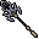
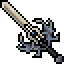
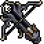
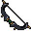

# Obsidian Gear

* Obsidian Gear is available for all vocations.
* Obsidian Gear has a level 150 requirement (as of November 2024).




| | Item | Def | Arm | Bonuses | Protection | Weight |
| - | - | - | - | - | - | - |
|  | **Obsidian Helmet** | – | 10 | One-handed +1 Two-handed +1 Distance +1 +0.5 HP/s +0.5 MP/s | Physical +3% Death +2% Holy -2% | 34.00 oz |
|  | **Obsidian Coat** | – | 16 | Magic Level +3 Speed +10 | Physical +3% Death +5% Holy -5% | 17.00 oz |
|  | **Obsidian Legs** | – | 9 | Speed +15 | Physical +4% Death +4% Holy -4% | 32.00 oz |
|  | **Obsidian Boots** | – | 3 | Magic Level +2 Speed +10 | Physical +2% Death +3% Holy -3% | 36.00 oz |
|  | **Obsidian Spellbinder** _Spellbook shield_ | 28 | – | Magic Level +4 | Physical +4% Death +8% Holy -8% | 22.00 oz |



| | Item | Element | Range | Bonuses | Weight |
| - | - | - | - | - | - |
|  | **Obsidian Wand** _Death damage, 150~ at +0_ | death | 6 | Magic Level +5 | 31.00 oz |



| | Item | Atk | Def | Bonuses | Weight |
| - | - | - | - | - | - |
|  | **Obsidian Great Axe** (two-handed) | 62 | 14 | Two-handed +4 | 150.00 oz |
|  | **Obsidian Sword** | 51 | 30 | One-handed +5 Attack Speed +0.10s | 35.00 oz |
|  | **Obsidian Axe** | 52 | 25 | One-handed +5 | 110.00 oz |



| | Item | Atk | Range | Bonuses | Weight |
| - | - | - | - | - | - |
|  | **Obsidian Crossbow** _Burning damage effect_ | 8 | 6 | Distance +5 Attack Speed +0.07s Hit +1% | 39.00 oz |
|  | **Obsidian Bow** _Burning damage effect_ | 7 | 7 | Distance +4 Fire damage +3% Hit +5% | 39.00 oz |



