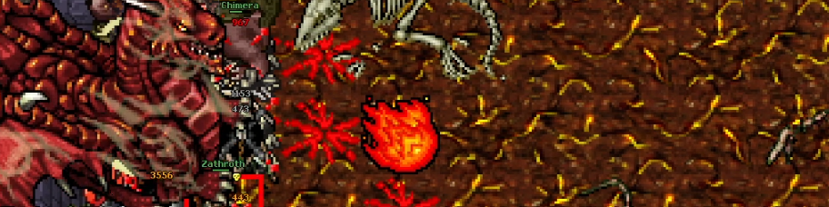

# Zathroth

<figure><figcaption></figcaption></figure>

**Level Required:** 120\
**Prerequisites:** [Lava Dragons](blue-crystal-lava-dragon-access.md)

* Head down towards the Lava Dragons spawn below An Old Dragonlord in Draconia.

&#x20; &#x20;

* Just before the Lava Dragons spawn is the door that leads to Zathroth.
* You must flip the lever in the Lava Dragons spawn to the south to make the red crystal vanish.
* Levitate down and head east after flipping the lever.
* Be prepared to meet Demons, Lava Dragons, Infernalists, Wights and Undead Dragons on the way.

* The portal in the center of the room will teleport you to Zathroth.
* After defeating Zathroth a teleport will lead you to the reward room.
* You will receive 1 Dragon Blood  and 220 000 experience when opening the chest.
* You will then be teleported back to Draconia.
* Deliver the Dragon Blood to An Old Dragonlord.

**Zathroth**

**Health:** 112,585\n**Experience:** 110,000

<details>

<summary>Zathroth loot table (40 items)</summary>

| Item                  | Chance | Max |
| --------------------- | -----: | --: |
| Demonic Essence       | 99.58% |   1 |
| Berserk Potion        |  87.7% |   1 |
| Knight Armor          | 70.93% |   1 |
| Gold Ingot            | 65.63% |   1 |
| Platinum Coin         | 49.79% |  29 |
| Assassin Star         | 40.03% | 100 |
| Ring Of Healing       |  32.5% |   1 |
| Magma Amulet          | 26.88% |   1 |
| Demon Shield          |  24.2% |   1 |
| Vampire Shield        |    19% |   1 |
| Golden Armor          | 18.85% |   1 |
| Mastermind Shield     | 18.11% |   1 |
| Life Crystal          | 15.14% |   1 |
| Onyx Flail            | 13.28% |   1 |
| Steel Boots           |    13% |   1 |
| Bloody Edge           |    11% |   1 |
| Royal Helmet          |  7.92% |   1 |
| Skullcracker Armor    |  7.53% |   1 |
| Ravager's Axe         |     7% |   1 |
| Zaoan Helmet          |   6.4% |   1 |
| Great Axe             |     6% |   1 |
| Heavy Mace            |     6% |   1 |
| Berserker             |   5.9% |   1 |
| Skull Helmet          |  5.45% |   1 |
| Crystal Fossil        |     5% |   2 |
| Spellweaver's Robe    |  2.85% |   1 |
| Earthborn Titan Armor |   2.5% |   1 |
| Crystalline Sword     |  1.94% |   1 |
| Crystal Crossbow      |  1.88% |   1 |
| Mycological Mace      |  1.64% |   1 |
| Blue Gem              |  1.17% |   1 |
| Crystalline Axe       |  1.12% |   1 |
| Shiny Blade           |  1.12% |   1 |
| Great Shield          |   1.1% |   1 |
| Royal Emblem          |     1% |   1 |
| Four-leaf Clover      |  0.25% |   1 |
| Crown Of Vigor        |   0.1% |   1 |
| Divine Phoenix        |   0.1% |   1 |
| Elite Emblem          |   0.1% |   1 |
| Frenzy Emblem         |   0.1% |   1 |

</details>

**Reward**

```
Player: hi
Player: mission
An Old Dragonlord: Did you get a dragon blood?
Player: yes
An Old Dragonlord: AMAZING HUMAN! PLEASE ACCEPT YOUR REWARD.
```

You may choose one of the following equipment.

You will also receive a ultimate healing backpack with two gem boxes and an amulet of loss from another chest at the reward spot.
