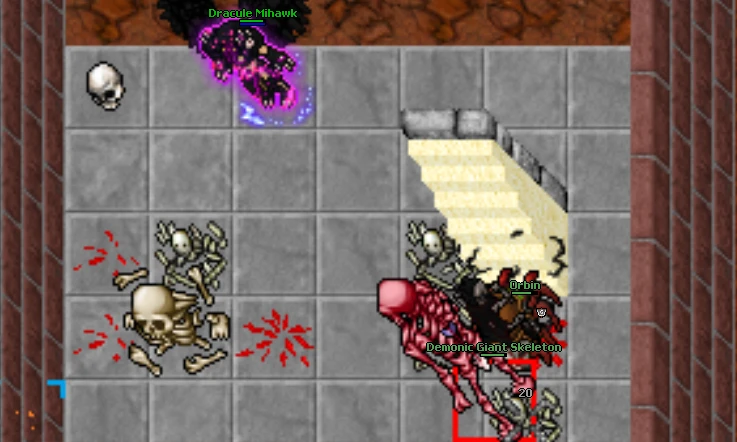

# Big Skeleton

The Giant Skeleton is a big skeleton in Rookgaard, usually considered a boss itself since it spawns randomly (typically only 1 per day) and it's location may vary.

* Prerequisites: None
* Health: 7,000
* Experience: 7,000

<figure><figcaption></figcaption></figure>

#### Directions 

The Giant Skeleton can randomly spawn on many Rookgaard places (almost on every skeleton respawn) but the most common places to check are:

* Teleskor spawn
* Skeletons on the way to Steve
* Skeletons on the premium area
* Skeletons on the way to the Giant Mole

<figure><figcaption></figcaption></figure>

#### Strategies 

It has really big amount of HP, but he is really slow so with a good bow and some patience you can start killing it by just running in circles. In almost every room / location its possible to run without any problems just make sure to not get trapped by other mobs.

Higher levels with good melee weapon can try to kill in close combat since his max. attack damage is not as high as Giant Mole or Avian expect hits of around 200HP (max).

**NOTE:** After killing Giant Skeleton there is a high chance that it appears as a Demonic Giant Skeleton (around 50% of the times). This demonic version is really powerful with more damage and **A LOT** more HP. You can apply the same strategy since demonic version is also a bit slow but expect a really long battle.

#### Loot 

The Giant Skeleton always drops Gold Ingot and Torch. Rare drops include Boots Of Strong Haste, Ring Of Souls and Chain Armor (g). Full loot table below.

Full loot table (35 items)

| Item                  | Chance | Max |
| --------------------- | -----: | --: |
| Gold Ingot            | Always |   1 |
| Torch                 | Always |   1 |
| Small Ruby            |    70% |   5 |
| Pick                  |  37.8% |   1 |
| Big Bone              |    25% |   1 |
| Brass Shield          |    24% |   1 |
| Sword                 |    24% |   1 |
| Gem Box               |    20% |   1 |
| Bone Sword            |    10% |   1 |
| Leather Legs          |    10% |   1 |
| Might Ring            |     7% |   1 |
| Bone Shield           |     4% |   1 |
| Longsword             |     4% |   1 |
| Iron Helmet           |   3.7% |   1 |
| Ice Cube              |   2.3% |   1 |
| Broadsword            |     2% |   1 |
| Battle Axe            |   1.5% |   1 |
| Royal Spear           |   1.2% |   3 |
| Voodoo Doll           |   1.2% |   1 |
| Dark Shield           |  1.12% |   1 |
| Brass Armor           |     1% |   1 |
| Chain Legs            |     1% |   1 |
| Giant Amethyst        |     1% |   1 |
| Giant Topaz           |     1% |   1 |
| Green Gem             |     1% |   1 |
| Soldier Helmet        |     1% |   1 |
| Time Ring             |     1% |   1 |
| Morning Star          |   0.6% |   1 |
| Guardian Shield       |   0.4% |   1 |
| Boots Of Haste        |   0.3% |   1 |
| Viking Helmet (g)     |   0.3% |   1 |
| Chain Armor (g)       |   0.1% |   1 |
| Sudden Death Rune     |   0.1% |   1 |
| Boots Of Strong Haste |  0.07% |   1 |
| Ring Of Souls         |  0.07% |   1 |

